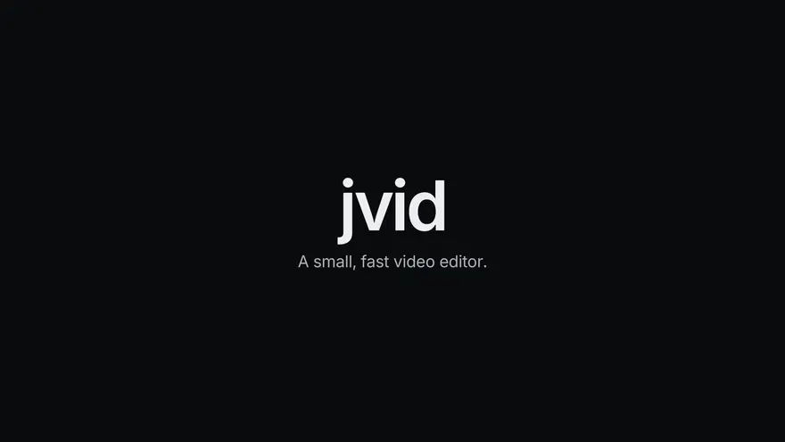

# jvid

[](docs/media/preview.mp4)

jvid is a small, fast video editor for quick edits: pull a highlight out of a long recording, trim a screen capture, add a title and export. It's written in Rust, draws its UI on the GPU and runs on Windows, macOS and Linux. Free and open source, no account.

It's in early development and isn't packaged yet; you [build it from source](#building).

- [User guide](docs/guide.md) and [shortcut cheat sheet](docs/shortcuts.md)
- [Plan](docs/PLAN.md): feature set, architecture and licensing
- [Roadmap](docs/ROADMAP.md): implementation order, milestones and issues

## What it does

- **Fast, keyboard-first editing.** In/out points, J/K/L, insert and overwrite, ripple trims, razor and split, markers. Every shortcut is remappable.
- **Quick to start.** Drag media onto the window; projects are plain JSON, autosaved, with relinking for moved files.
- **Proxies.** Low-res copies of 4K and HEVC sources made in the background for smooth scrubbing; export uses the originals.
- **Titles and solids.** Text presets with font, outline, shadow and box in the Inspector.
- **Keyframes.** Transform, opacity, blend mode, crop, color and volume, with an easing editor and zoom-to-region on the Program monitor.
- **Transitions and audio.** Crossfades and dips on cuts, clip fades, and a volume line on each clip.
- **Effects.** WGSL shader effects with keyframeable parameters; [write your own](docs/effects.md).
- **Export.** Presets for highlights, screen recordings, YouTube, Shorts/Reels and ProRes, a background Render Queue, and `jvid render` for exporting from the command line.

## Building

jvid needs a Rust toolchain from [rustup](https://rustup.rs). `rust-toolchain.toml` pins the stable channel, so rustup installs the right toolchain, with `rustfmt` and `clippy`, the first time you run `cargo` in the repo.

It also needs the FFmpeg 4.4 to 8.x development libraries, `pkg-config` and libclang; the per-OS commands are in [CONTRIBUTING.md](CONTRIBUTING.md#developer-setup).

```sh
cargo build --workspace
cargo test --workspace
cargo run --release -p jvid-app    # the desktop app
cargo run --release -p jvid-cli -- render project.jvid -o out.mp4    # headless render
```

H.264 export needs working hardware encoding or an FFmpeg build with OpenH264 (`libopenh264`). Software x264/x265 require a GPL FFmpeg build and jvid built with `--features gpl-ffmpeg`; installing a GPL FFmpeg alone does not enable them. Export never substitutes MPEG-4 Part 2 for H.264. If no encoder supports the requested family and settings, install a supported build or explicitly choose another preset such as ProRes Master or GIF. The export dialog lists encoder candidates in preference order; the log records the encoder actually opened.

`scripts/preview/build` regenerates the preview at the top of this page. It drives the real app frame by frame, then lays the capture out with [HyperFrames](https://github.com/heygen-com/hyperframes) from `scripts/preview/motion.html`. It needs the FFmpeg command line tools, Node 22 or later and a Vulkan driver (Mesa's lavapipe works), and downloads its footage once into `target/preview/`.

## Workspace

| Crate | Role |
| --- | --- |
| [`jvid-core`](crates/jvid-core) | Project model, timeline, keyframes, commands and undo, serialization. No I/O, no UI. |
| [`jvid-media`](crates/jvid-media) | FFmpeg probe, decode and encode, thumbnails, waveforms, proxies |
| [`jvid-render`](crates/jvid-render) | wgpu compositor, transforms, blend modes, color, WGSL effects |
| [`jvid-audio`](crates/jvid-audio) | Mixer, cpal output, resampling, loudness |
| [`jvid-app`](crates/jvid-app) | eframe desktop app |
| [`jvid-cli`](crates/jvid-cli) | Headless render |
| [`suite-ui`](crates/suite-ui) | Shared theme, widgets and keybinding system for the whole suite |

## Contributing

See [CONTRIBUTING.md](CONTRIBUTING.md).

## Credits

The preview uses footage from [Tears of Steel](https://mango.blender.org), (CC) Blender Foundation | mango.blender.org, licensed [CC BY 3.0](https://creativecommons.org/licenses/by/3.0/).

## License

Licensed under either of [MIT](LICENSE-MIT) or [Apache-2.0](LICENSE-APACHE), at your option. Release builds bundle FFmpeg, which has its own license; see [PLAN.md · Licensing](docs/PLAN.md#licensing).

Unless you explicitly state otherwise, any contribution intentionally submitted for inclusion in jvid by you, as defined in the Apache-2.0 license, shall be dual licensed as above, without any additional terms or conditions.
