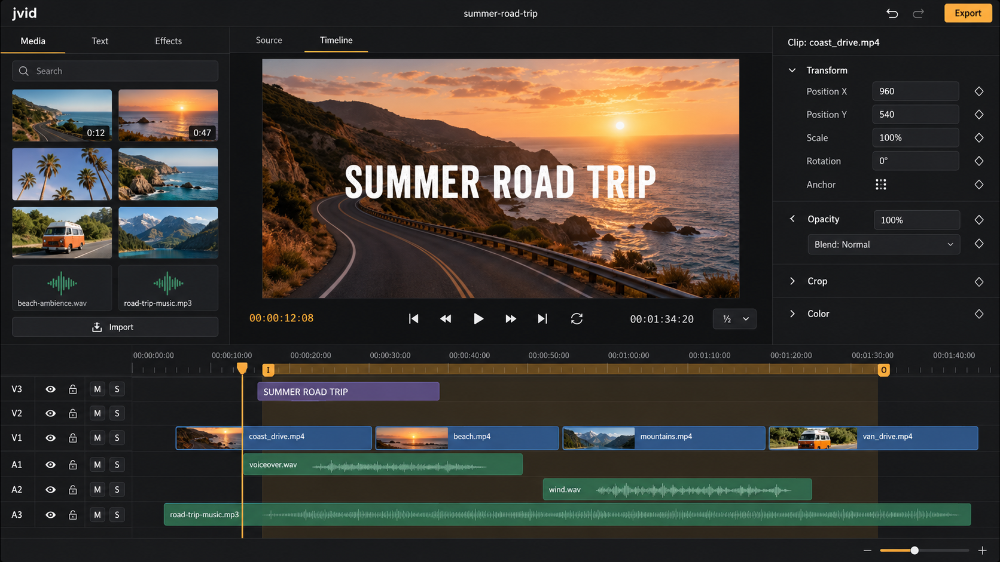

# jvid

A lightweight, fast, cross-platform video editor written in Rust. It's for quick clip editing: trim, stitch, title, add music and export, without the weight of a full NLE.

jvid is the first tool in a planned suite of small, high-performance, open source apps.

> **Status:** planning. Nothing is implemented yet; the screenshot is a generated prototype.

- [Plan](docs/PLAN.md): feature set, architecture and licensing
- [Roadmap](docs/ROADMAP.md): implementation order, milestones and issues
- [UI prototypes](docs/prototypes/): main editor, keyframe editing, export dialog, welcome screen

## License

Licensed under either of [MIT](LICENSE-MIT) or [Apache-2.0](LICENSE-APACHE), at your option. Release builds bundle FFmpeg, which has its own license; see [PLAN.md · Licensing](docs/PLAN.md#licensing).
