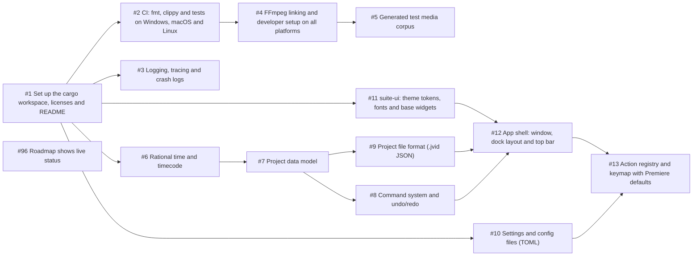
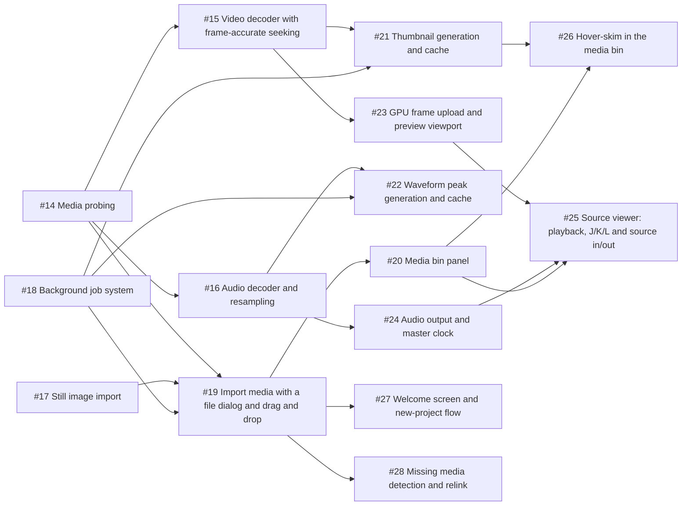
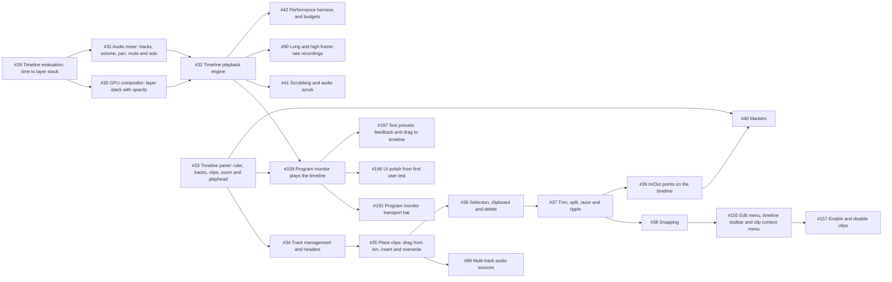
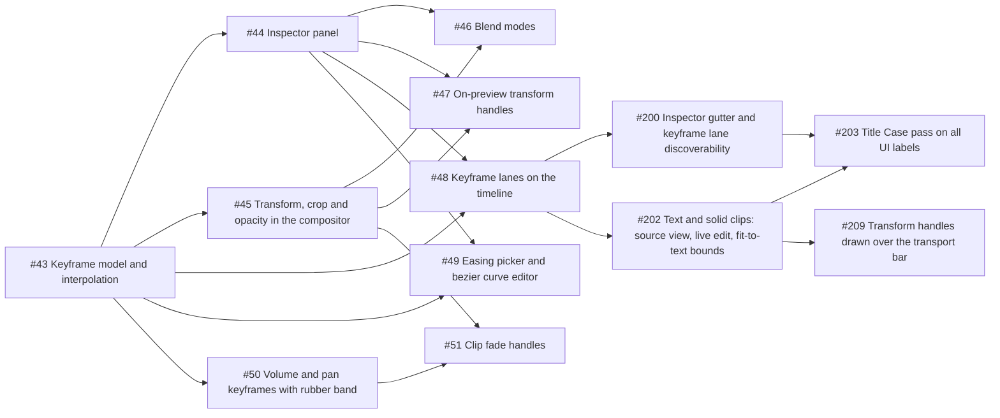
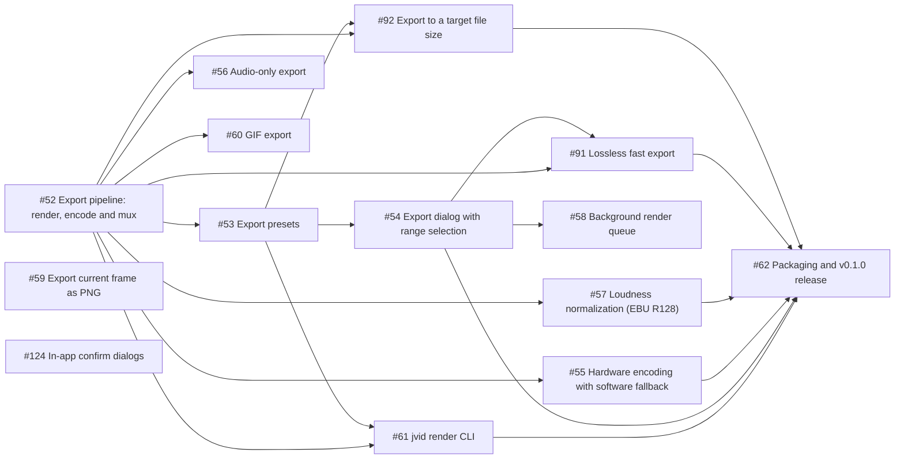
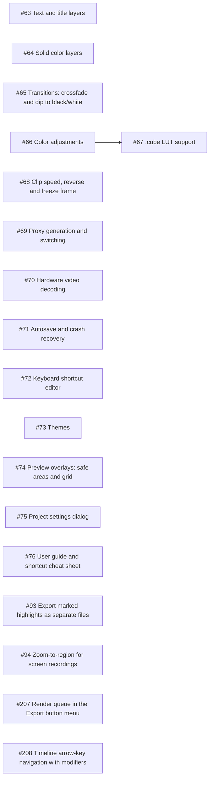
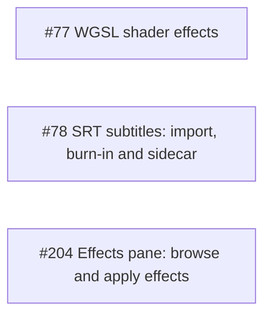

# jvid roadmap

The order jvid gets built in. Every item is a GitHub issue with scope, acceptance criteria and dependencies. The feature set and architecture behind them are in [PLAN.md](PLAN.md).

**Picking up work:** take the first open issue in the current milestone's table whose dependencies are all closed. The tables below are in build order, so issue numbers don't always follow it. Issues tagged [`good first issue`](https://github.com/jarradbanks/jvid/labels/good%20first%20issue) are self-contained.

## Releases

| Release | Milestones | What you can do |
| --- | --- | --- |
| **v0.1.0** | [M0 · Foundations](https://github.com/jarradbanks/jvid/milestone/1), [M1 · Media & Preview](https://github.com/jarradbanks/jvid/milestone/2), [M2 · Timeline](https://github.com/jarradbanks/jvid/milestone/3), [M3 · Animate](https://github.com/jarradbanks/jvid/milestone/4), [M4 · Export & v0.1.0](https://github.com/jarradbanks/jvid/milestone/5) | The first usable quick editor: import, cut, layer, animate, export. |
| **v0.2.0** | [M5 · Polish (v0.2.0)](https://github.com/jarradbanks/jvid/milestone/6) | Titles, transitions, color, speed, and the performance work that makes 4K comfortable. |
| **v0.3.0** | [M6 · Extend (v0.3.0)](https://github.com/jarradbanks/jvid/milestone/7) | Extensibility: user shader effects and subtitles. |

## How the order was chosen

1. **Biggest risks first.** FFmpeg linking on three platforms and frame-accurate decoding of long, variable-frame-rate recordings are the parts most likely to go wrong, so they land in M0 and M1.
2. **Model before UI.** Time, the project model and undo/redo exist before anything edits a project, so every feature is undoable and saveable from its first commit.
3. **Playable early.** By the end of M2 you can cut a multi-layer timeline and play it back. M3 adds animation; M4 makes it exportable and ships v0.1.0.
4. **One evaluation path.** Playback, export and the CLI all use the same timeline evaluation ([#29](https://github.com/jarradbanks/jvid/issues/29)), so what you see is what you export.
5. **Polish after usefulness.** Titles, transitions, color and proxies wait for v0.2.0; they build on the transform and keyframe work rather than shaping it.

## Critical path

The longest chain of dependent issues, about **67 person-days**. Everything else can happen alongside it.

[#1](https://github.com/jarradbanks/jvid/issues/1) Set up the cargo workspace, licenses and README → [#2](https://github.com/jarradbanks/jvid/issues/2) CI: fmt, clippy and tests on Windows, macOS and Linux → [#4](https://github.com/jarradbanks/jvid/issues/4) FFmpeg linking and developer setup on all platforms → [#5](https://github.com/jarradbanks/jvid/issues/5) Generated test media corpus → [#14](https://github.com/jarradbanks/jvid/issues/14) Media probing → [#15](https://github.com/jarradbanks/jvid/issues/15) Video decoder with frame-accurate seeking → [#21](https://github.com/jarradbanks/jvid/issues/21) Thumbnail generation and cache → [#33](https://github.com/jarradbanks/jvid/issues/33) Timeline panel: ruler, tracks, clips, zoom and playhead → [#34](https://github.com/jarradbanks/jvid/issues/34) Track management and headers → [#35](https://github.com/jarradbanks/jvid/issues/35) Place clips: drag from bin, insert and overwrite → [#36](https://github.com/jarradbanks/jvid/issues/36) Selection, clipboard and delete → [#37](https://github.com/jarradbanks/jvid/issues/37) Trim, split, razor and ripple → [#39](https://github.com/jarradbanks/jvid/issues/39) In/Out points on the timeline → [#54](https://github.com/jarradbanks/jvid/issues/54) Export dialog with range selection → [#91](https://github.com/jarradbanks/jvid/issues/91) Lossless fast export → [#62](https://github.com/jarradbanks/jvid/issues/62) Packaging and v0.1.0 release

## Parallel tracks

After M0, work splits into tracks that rarely block each other:

| Track | Crates | Issues |
| --- | --- | --- |
| Core | `jvid-core` | [#6](https://github.com/jarradbanks/jvid/issues/6) [#7](https://github.com/jarradbanks/jvid/issues/7) [#8](https://github.com/jarradbanks/jvid/issues/8) [#9](https://github.com/jarradbanks/jvid/issues/9) [#10](https://github.com/jarradbanks/jvid/issues/10) [#18](https://github.com/jarradbanks/jvid/issues/18) [#29](https://github.com/jarradbanks/jvid/issues/29) [#43](https://github.com/jarradbanks/jvid/issues/43) [#68](https://github.com/jarradbanks/jvid/issues/68) [#71](https://github.com/jarradbanks/jvid/issues/71) |
| Media | `jvid-media` | [#4](https://github.com/jarradbanks/jvid/issues/4) [#5](https://github.com/jarradbanks/jvid/issues/5) [#14](https://github.com/jarradbanks/jvid/issues/14) [#15](https://github.com/jarradbanks/jvid/issues/15) [#16](https://github.com/jarradbanks/jvid/issues/16) [#17](https://github.com/jarradbanks/jvid/issues/17) [#19](https://github.com/jarradbanks/jvid/issues/19) [#21](https://github.com/jarradbanks/jvid/issues/21) [#28](https://github.com/jarradbanks/jvid/issues/28) [#89](https://github.com/jarradbanks/jvid/issues/89) [#90](https://github.com/jarradbanks/jvid/issues/90) [#52](https://github.com/jarradbanks/jvid/issues/52) [#55](https://github.com/jarradbanks/jvid/issues/55) [#91](https://github.com/jarradbanks/jvid/issues/91) [#69](https://github.com/jarradbanks/jvid/issues/69) [#70](https://github.com/jarradbanks/jvid/issues/70) |
| Render | `jvid-render` | [#23](https://github.com/jarradbanks/jvid/issues/23) [#30](https://github.com/jarradbanks/jvid/issues/30) [#32](https://github.com/jarradbanks/jvid/issues/32) [#157](https://github.com/jarradbanks/jvid/issues/157) [#159](https://github.com/jarradbanks/jvid/issues/159) [#41](https://github.com/jarradbanks/jvid/issues/41) [#45](https://github.com/jarradbanks/jvid/issues/45) [#46](https://github.com/jarradbanks/jvid/issues/46) [#47](https://github.com/jarradbanks/jvid/issues/47) [#63](https://github.com/jarradbanks/jvid/issues/63) [#64](https://github.com/jarradbanks/jvid/issues/64) [#65](https://github.com/jarradbanks/jvid/issues/65) [#66](https://github.com/jarradbanks/jvid/issues/66) [#67](https://github.com/jarradbanks/jvid/issues/67) [#70](https://github.com/jarradbanks/jvid/issues/70) [#94](https://github.com/jarradbanks/jvid/issues/94) [#77](https://github.com/jarradbanks/jvid/issues/77) [#78](https://github.com/jarradbanks/jvid/issues/78) [#202](https://github.com/jarradbanks/jvid/issues/202) |
| Audio | `jvid-audio` | [#16](https://github.com/jarradbanks/jvid/issues/16) [#22](https://github.com/jarradbanks/jvid/issues/22) [#24](https://github.com/jarradbanks/jvid/issues/24) [#31](https://github.com/jarradbanks/jvid/issues/31) [#32](https://github.com/jarradbanks/jvid/issues/32) [#50](https://github.com/jarradbanks/jvid/issues/50) [#56](https://github.com/jarradbanks/jvid/issues/56) [#57](https://github.com/jarradbanks/jvid/issues/57) |
| UI and timeline | `jvid-app`, `suite-ui` | [#11](https://github.com/jarradbanks/jvid/issues/11) [#12](https://github.com/jarradbanks/jvid/issues/12) [#13](https://github.com/jarradbanks/jvid/issues/13) [#19](https://github.com/jarradbanks/jvid/issues/19) [#20](https://github.com/jarradbanks/jvid/issues/20) [#25](https://github.com/jarradbanks/jvid/issues/25) [#26](https://github.com/jarradbanks/jvid/issues/26) [#27](https://github.com/jarradbanks/jvid/issues/27) [#28](https://github.com/jarradbanks/jvid/issues/28) [#33](https://github.com/jarradbanks/jvid/issues/33) [#34](https://github.com/jarradbanks/jvid/issues/34) [#35](https://github.com/jarradbanks/jvid/issues/35) [#89](https://github.com/jarradbanks/jvid/issues/89) [#36](https://github.com/jarradbanks/jvid/issues/36) [#37](https://github.com/jarradbanks/jvid/issues/37) [#38](https://github.com/jarradbanks/jvid/issues/38) [#155](https://github.com/jarradbanks/jvid/issues/155) [#157](https://github.com/jarradbanks/jvid/issues/157) [#159](https://github.com/jarradbanks/jvid/issues/159) [#191](https://github.com/jarradbanks/jvid/issues/191) [#196](https://github.com/jarradbanks/jvid/issues/196) [#197](https://github.com/jarradbanks/jvid/issues/197) [#39](https://github.com/jarradbanks/jvid/issues/39) [#40](https://github.com/jarradbanks/jvid/issues/40) [#41](https://github.com/jarradbanks/jvid/issues/41) [#90](https://github.com/jarradbanks/jvid/issues/90) [#44](https://github.com/jarradbanks/jvid/issues/44) [#47](https://github.com/jarradbanks/jvid/issues/47) [#48](https://github.com/jarradbanks/jvid/issues/48) [#49](https://github.com/jarradbanks/jvid/issues/49) [#50](https://github.com/jarradbanks/jvid/issues/50) [#51](https://github.com/jarradbanks/jvid/issues/51) [#54](https://github.com/jarradbanks/jvid/issues/54) [#58](https://github.com/jarradbanks/jvid/issues/58) [#63](https://github.com/jarradbanks/jvid/issues/63) [#65](https://github.com/jarradbanks/jvid/issues/65) [#68](https://github.com/jarradbanks/jvid/issues/68) [#72](https://github.com/jarradbanks/jvid/issues/72) [#73](https://github.com/jarradbanks/jvid/issues/73) [#74](https://github.com/jarradbanks/jvid/issues/74) [#75](https://github.com/jarradbanks/jvid/issues/75) [#93](https://github.com/jarradbanks/jvid/issues/93) [#94](https://github.com/jarradbanks/jvid/issues/94) [#77](https://github.com/jarradbanks/jvid/issues/77) [#200](https://github.com/jarradbanks/jvid/issues/200) [#202](https://github.com/jarradbanks/jvid/issues/202) [#203](https://github.com/jarradbanks/jvid/issues/203) [#204](https://github.com/jarradbanks/jvid/issues/204) [#207](https://github.com/jarradbanks/jvid/issues/207) [#208](https://github.com/jarradbanks/jvid/issues/208) [#209](https://github.com/jarradbanks/jvid/issues/209) [#124](https://github.com/jarradbanks/jvid/issues/124) |
| Export and CLI | `jvid-media`, `jvid-cli` | [#52](https://github.com/jarradbanks/jvid/issues/52) [#53](https://github.com/jarradbanks/jvid/issues/53) [#54](https://github.com/jarradbanks/jvid/issues/54) [#55](https://github.com/jarradbanks/jvid/issues/55) [#56](https://github.com/jarradbanks/jvid/issues/56) [#57](https://github.com/jarradbanks/jvid/issues/57) [#58](https://github.com/jarradbanks/jvid/issues/58) [#59](https://github.com/jarradbanks/jvid/issues/59) [#60](https://github.com/jarradbanks/jvid/issues/60) [#91](https://github.com/jarradbanks/jvid/issues/91) [#92](https://github.com/jarradbanks/jvid/issues/92) [#61](https://github.com/jarradbanks/jvid/issues/61) [#93](https://github.com/jarradbanks/jvid/issues/93) [#78](https://github.com/jarradbanks/jvid/issues/78) [#207](https://github.com/jarradbanks/jvid/issues/207) |

## Milestones

Sizes: **S** up to a day, **M** two to four days, **L** one to two weeks. Person-day totals are rough, for one developer.

### [M0 · Foundations](https://github.com/jarradbanks/jvid/milestone/1)

Workspace, CI, FFmpeg setup, project model, undo/redo, file format, app shell, theme, keymap. 14 issues, about 26 person-days.

| Issue | Title | Status | Size | Area | Depends on |
| --- | --- | --- | --- | --- | --- |
| [#1](https://github.com/jarradbanks/jvid/issues/1) | Set up the cargo workspace, licenses and README | done | S | infra | — |
| [#2](https://github.com/jarradbanks/jvid/issues/2) | CI: fmt, clippy and tests on Windows, macOS and Linux | done | S | infra | [#1](https://github.com/jarradbanks/jvid/issues/1) |
| [#3](https://github.com/jarradbanks/jvid/issues/3) | Logging, tracing and crash logs | done | S | infra | [#1](https://github.com/jarradbanks/jvid/issues/1) |
| [#96](https://github.com/jarradbanks/jvid/issues/96) | Roadmap shows live status | done | S | infra | — |
| [#4](https://github.com/jarradbanks/jvid/issues/4) | FFmpeg linking and developer setup on all platforms | done | M | infra, media | [#2](https://github.com/jarradbanks/jvid/issues/2) |
| [#5](https://github.com/jarradbanks/jvid/issues/5) | Generated test media corpus | done | S | infra, media | [#4](https://github.com/jarradbanks/jvid/issues/4) |
| [#6](https://github.com/jarradbanks/jvid/issues/6) | Rational time and timecode | done | S | core | [#1](https://github.com/jarradbanks/jvid/issues/1) |
| [#7](https://github.com/jarradbanks/jvid/issues/7) | Project data model | done | M | core | [#6](https://github.com/jarradbanks/jvid/issues/6) |
| [#8](https://github.com/jarradbanks/jvid/issues/8) | Command system and undo/redo | done | M | core | [#7](https://github.com/jarradbanks/jvid/issues/7) |
| [#9](https://github.com/jarradbanks/jvid/issues/9) | Project file format (.jvid JSON) | done | S | core | [#7](https://github.com/jarradbanks/jvid/issues/7) |
| [#10](https://github.com/jarradbanks/jvid/issues/10) | Settings and config files (TOML) | done | S | core | [#1](https://github.com/jarradbanks/jvid/issues/1) |
| [#11](https://github.com/jarradbanks/jvid/issues/11) | suite-ui: theme tokens, fonts and base widgets | need testing | M | suite-ui | [#1](https://github.com/jarradbanks/jvid/issues/1) |
| [#12](https://github.com/jarradbanks/jvid/issues/12) | App shell: window, dock layout and top bar | need testing | M | ui | [#11](https://github.com/jarradbanks/jvid/issues/11), [#9](https://github.com/jarradbanks/jvid/issues/9), [#8](https://github.com/jarradbanks/jvid/issues/8) |
| [#13](https://github.com/jarradbanks/jvid/issues/13) | Action registry and keymap with Premiere defaults | done | M | ui | [#12](https://github.com/jarradbanks/jvid/issues/12), [#10](https://github.com/jarradbanks/jvid/issues/10) |

### [M1 · Media & Preview](https://github.com/jarradbanks/jvid/milestone/2)

Probe, decode, import, media bin, thumbnails, waveforms, GPU preview, audio output, source viewer, welcome screen. 15 issues, about 49 person-days.

| Issue | Title | Status | Size | Area | Depends on |
| --- | --- | --- | --- | --- | --- |
| [#14](https://github.com/jarradbanks/jvid/issues/14) | Media probing | done | M | media | [#4](https://github.com/jarradbanks/jvid/issues/4), [#7](https://github.com/jarradbanks/jvid/issues/7), [#5](https://github.com/jarradbanks/jvid/issues/5) |
| [#15](https://github.com/jarradbanks/jvid/issues/15) | Video decoder with frame-accurate seeking | done | L | media | [#14](https://github.com/jarradbanks/jvid/issues/14) |
| [#16](https://github.com/jarradbanks/jvid/issues/16) | Audio decoder and resampling | done | M | media, audio | [#14](https://github.com/jarradbanks/jvid/issues/14) |
| [#17](https://github.com/jarradbanks/jvid/issues/17) | Still image import | done | S | media | [#7](https://github.com/jarradbanks/jvid/issues/7) |
| [#18](https://github.com/jarradbanks/jvid/issues/18) | Background job system | need testing | M | core | [#1](https://github.com/jarradbanks/jvid/issues/1) |
| [#19](https://github.com/jarradbanks/jvid/issues/19) | Import media with a file dialog and drag and drop | done | M | ui, media | [#14](https://github.com/jarradbanks/jvid/issues/14), [#17](https://github.com/jarradbanks/jvid/issues/17), [#18](https://github.com/jarradbanks/jvid/issues/18), [#12](https://github.com/jarradbanks/jvid/issues/12) |
| [#20](https://github.com/jarradbanks/jvid/issues/20) | Media bin panel | done | M | ui | [#19](https://github.com/jarradbanks/jvid/issues/19) |
| [#21](https://github.com/jarradbanks/jvid/issues/21) | Thumbnail generation and cache | done | M | media | [#15](https://github.com/jarradbanks/jvid/issues/15), [#18](https://github.com/jarradbanks/jvid/issues/18) |
| [#22](https://github.com/jarradbanks/jvid/issues/22) | Waveform peak generation and cache | done | M | audio | [#16](https://github.com/jarradbanks/jvid/issues/16), [#18](https://github.com/jarradbanks/jvid/issues/18) |
| [#23](https://github.com/jarradbanks/jvid/issues/23) | GPU frame upload and preview viewport | need testing | M | render | [#15](https://github.com/jarradbanks/jvid/issues/15), [#12](https://github.com/jarradbanks/jvid/issues/12) |
| [#24](https://github.com/jarradbanks/jvid/issues/24) | Audio output and master clock | done | M | audio | [#16](https://github.com/jarradbanks/jvid/issues/16) |
| [#25](https://github.com/jarradbanks/jvid/issues/25) | Source viewer: playback, J/K/L and source in/out | need testing | L | ui | [#23](https://github.com/jarradbanks/jvid/issues/23), [#24](https://github.com/jarradbanks/jvid/issues/24), [#13](https://github.com/jarradbanks/jvid/issues/13), [#20](https://github.com/jarradbanks/jvid/issues/20) |
| [#26](https://github.com/jarradbanks/jvid/issues/26) | Hover-skim in the media bin | done | S | ui | [#21](https://github.com/jarradbanks/jvid/issues/21), [#20](https://github.com/jarradbanks/jvid/issues/20) |
| [#27](https://github.com/jarradbanks/jvid/issues/27) | Welcome screen and new-project flow | need testing | M | ui | [#12](https://github.com/jarradbanks/jvid/issues/12), [#10](https://github.com/jarradbanks/jvid/issues/10), [#19](https://github.com/jarradbanks/jvid/issues/19) |
| [#28](https://github.com/jarradbanks/jvid/issues/28) | Missing media detection and relink | need testing | S | ui, media | [#19](https://github.com/jarradbanks/jvid/issues/19), [#9](https://github.com/jarradbanks/jvid/issues/9) |

### [M2 · Timeline](https://github.com/jarradbanks/jvid/milestone/3)

Timeline panel, tracks, clip placement, trim/split/ripple, snapping, in/out, compositor, mixer, playback. 22 issues, about 76 person-days.

| Issue | Title | Status | Size | Area | Depends on |
| --- | --- | --- | --- | --- | --- |
| [#29](https://github.com/jarradbanks/jvid/issues/29) | Timeline evaluation: time to layer stack | done | M | core | [#7](https://github.com/jarradbanks/jvid/issues/7) |
| [#30](https://github.com/jarradbanks/jvid/issues/30) | GPU compositor: layer stack with opacity | done | L | render | [#29](https://github.com/jarradbanks/jvid/issues/29), [#23](https://github.com/jarradbanks/jvid/issues/23) |
| [#31](https://github.com/jarradbanks/jvid/issues/31) | Audio mixer: tracks, volume, pan, mute and solo | done | M | audio | [#29](https://github.com/jarradbanks/jvid/issues/29), [#16](https://github.com/jarradbanks/jvid/issues/16) |
| [#32](https://github.com/jarradbanks/jvid/issues/32) | Timeline playback engine | need testing | L | render, audio | [#30](https://github.com/jarradbanks/jvid/issues/30), [#31](https://github.com/jarradbanks/jvid/issues/31), [#24](https://github.com/jarradbanks/jvid/issues/24) |
| [#33](https://github.com/jarradbanks/jvid/issues/33) | Timeline panel: ruler, tracks, clips, zoom and playhead | need testing | L | ui, timeline | [#12](https://github.com/jarradbanks/jvid/issues/12), [#7](https://github.com/jarradbanks/jvid/issues/7), [#21](https://github.com/jarradbanks/jvid/issues/21), [#22](https://github.com/jarradbanks/jvid/issues/22) |
| [#34](https://github.com/jarradbanks/jvid/issues/34) | Track management and headers | done | M | timeline | [#33](https://github.com/jarradbanks/jvid/issues/33), [#8](https://github.com/jarradbanks/jvid/issues/8) |
| [#35](https://github.com/jarradbanks/jvid/issues/35) | Place clips: drag from bin, insert and overwrite | done | M | timeline | [#34](https://github.com/jarradbanks/jvid/issues/34), [#25](https://github.com/jarradbanks/jvid/issues/25) |
| [#89](https://github.com/jarradbanks/jvid/issues/89) | Multi-track audio sources | done | M | timeline, media | [#35](https://github.com/jarradbanks/jvid/issues/35), [#16](https://github.com/jarradbanks/jvid/issues/16) |
| [#36](https://github.com/jarradbanks/jvid/issues/36) | Selection, clipboard and delete | done | M | timeline | [#35](https://github.com/jarradbanks/jvid/issues/35) |
| [#37](https://github.com/jarradbanks/jvid/issues/37) | Trim, split, razor and ripple | done | L | timeline | [#36](https://github.com/jarradbanks/jvid/issues/36) |
| [#38](https://github.com/jarradbanks/jvid/issues/38) | Snapping | done | S | timeline | [#37](https://github.com/jarradbanks/jvid/issues/37) |
| [#155](https://github.com/jarradbanks/jvid/issues/155) | Edit menu, timeline toolbar and clip context menu | done | M | ui, timeline | [#38](https://github.com/jarradbanks/jvid/issues/38) |
| [#157](https://github.com/jarradbanks/jvid/issues/157) | Enable and disable clips | done | S | timeline, render | [#155](https://github.com/jarradbanks/jvid/issues/155) |
| [#159](https://github.com/jarradbanks/jvid/issues/159) | Program monitor plays the timeline | need testing | M | ui, render | [#32](https://github.com/jarradbanks/jvid/issues/32), [#33](https://github.com/jarradbanks/jvid/issues/33) |
| [#191](https://github.com/jarradbanks/jvid/issues/191) | Program monitor transport bar | done | S | ui | [#159](https://github.com/jarradbanks/jvid/issues/159) |
| [#196](https://github.com/jarradbanks/jvid/issues/196) | UI polish from first user test | done | S | ui | [#159](https://github.com/jarradbanks/jvid/issues/159) |
| [#197](https://github.com/jarradbanks/jvid/issues/197) | Text presets: feedback and drag to timeline | done | S | ui, timeline | [#159](https://github.com/jarradbanks/jvid/issues/159) |
| [#39](https://github.com/jarradbanks/jvid/issues/39) | In/Out points on the timeline | done | M | timeline | [#37](https://github.com/jarradbanks/jvid/issues/37), [#13](https://github.com/jarradbanks/jvid/issues/13) |
| [#40](https://github.com/jarradbanks/jvid/issues/40) | Markers | done | M | timeline | [#33](https://github.com/jarradbanks/jvid/issues/33), [#8](https://github.com/jarradbanks/jvid/issues/8), [#39](https://github.com/jarradbanks/jvid/issues/39) |
| [#41](https://github.com/jarradbanks/jvid/issues/41) | Scrubbing and audio scrub | done | M | timeline, render | [#32](https://github.com/jarradbanks/jvid/issues/32) |
| [#90](https://github.com/jarradbanks/jvid/issues/90) | Long and high-frame-rate recordings | done | M | media, timeline | [#32](https://github.com/jarradbanks/jvid/issues/32), [#21](https://github.com/jarradbanks/jvid/issues/21), [#22](https://github.com/jarradbanks/jvid/issues/22) |
| [#42](https://github.com/jarradbanks/jvid/issues/42) | Performance harness and budgets | done | M | infra | [#32](https://github.com/jarradbanks/jvid/issues/32) |

### [M3 · Animate](https://github.com/jarradbanks/jvid/milestone/4)

Keyframes with easing, inspector, transform/crop/opacity/blend, preview gizmo, keyframe lanes, audio automation. 13 issues, about 39 person-days.

| Issue | Title | Status | Size | Area | Depends on |
| --- | --- | --- | --- | --- | --- |
| [#43](https://github.com/jarradbanks/jvid/issues/43) | Keyframe model and interpolation | done | M | core | [#7](https://github.com/jarradbanks/jvid/issues/7), [#8](https://github.com/jarradbanks/jvid/issues/8) |
| [#44](https://github.com/jarradbanks/jvid/issues/44) | Inspector panel | done | L | ui | [#12](https://github.com/jarradbanks/jvid/issues/12), [#43](https://github.com/jarradbanks/jvid/issues/43), [#36](https://github.com/jarradbanks/jvid/issues/36) |
| [#45](https://github.com/jarradbanks/jvid/issues/45) | Transform, crop and opacity in the compositor | done | M | render | [#30](https://github.com/jarradbanks/jvid/issues/30), [#43](https://github.com/jarradbanks/jvid/issues/43) |
| [#46](https://github.com/jarradbanks/jvid/issues/46) | Blend modes | done | S | render | [#45](https://github.com/jarradbanks/jvid/issues/45), [#44](https://github.com/jarradbanks/jvid/issues/44) |
| [#47](https://github.com/jarradbanks/jvid/issues/47) | On-preview transform handles | done | M | ui, render | [#45](https://github.com/jarradbanks/jvid/issues/45), [#44](https://github.com/jarradbanks/jvid/issues/44) |
| [#48](https://github.com/jarradbanks/jvid/issues/48) | Keyframe lanes on the timeline | done | L | timeline | [#43](https://github.com/jarradbanks/jvid/issues/43), [#33](https://github.com/jarradbanks/jvid/issues/33), [#44](https://github.com/jarradbanks/jvid/issues/44) |
| [#49](https://github.com/jarradbanks/jvid/issues/49) | Easing picker and bezier curve editor | done | M | ui | [#43](https://github.com/jarradbanks/jvid/issues/43), [#44](https://github.com/jarradbanks/jvid/issues/44) |
| [#50](https://github.com/jarradbanks/jvid/issues/50) | Volume and pan keyframes with rubber band | done | M | audio, timeline | [#43](https://github.com/jarradbanks/jvid/issues/43), [#31](https://github.com/jarradbanks/jvid/issues/31), [#33](https://github.com/jarradbanks/jvid/issues/33) |
| [#51](https://github.com/jarradbanks/jvid/issues/51) | Clip fade handles | done | S | timeline | [#50](https://github.com/jarradbanks/jvid/issues/50), [#45](https://github.com/jarradbanks/jvid/issues/45) |
| [#200](https://github.com/jarradbanks/jvid/issues/200) | Inspector gutter and keyframe lane discoverability | need testing | S | ui, timeline | [#48](https://github.com/jarradbanks/jvid/issues/48) |
| [#202](https://github.com/jarradbanks/jvid/issues/202) | Text and solid clips: source view, live edit, fit-to-text bounds | in progress | M | ui, render | [#48](https://github.com/jarradbanks/jvid/issues/48) |
| [#203](https://github.com/jarradbanks/jvid/issues/203) | Title Case pass on all UI labels |  | S | ui, suite-ui | [#202](https://github.com/jarradbanks/jvid/issues/202), [#200](https://github.com/jarradbanks/jvid/issues/200) |
| [#209](https://github.com/jarradbanks/jvid/issues/209) | Transform handles drawn over the transport bar |  | S | ui | [#202](https://github.com/jarradbanks/jvid/issues/202) |

### [M4 · Export & v0.1.0](https://github.com/jarradbanks/jvid/milestone/5)

Export pipeline, presets, export dialog with In to Out, hardware encode, loudness, queue, CLI render, release packaging. 14 issues, about 51 person-days.

| Issue | Title | Status | Size | Area | Depends on |
| --- | --- | --- | --- | --- | --- |
| [#52](https://github.com/jarradbanks/jvid/issues/52) | Export pipeline: render, encode and mux | done | L | export, media | [#30](https://github.com/jarradbanks/jvid/issues/30), [#31](https://github.com/jarradbanks/jvid/issues/31), [#45](https://github.com/jarradbanks/jvid/issues/45) |
| [#53](https://github.com/jarradbanks/jvid/issues/53) | Export presets | done | M | export | [#52](https://github.com/jarradbanks/jvid/issues/52) |
| [#54](https://github.com/jarradbanks/jvid/issues/54) | Export dialog with range selection | done | M | ui, export | [#53](https://github.com/jarradbanks/jvid/issues/53), [#39](https://github.com/jarradbanks/jvid/issues/39), [#36](https://github.com/jarradbanks/jvid/issues/36) |
| [#55](https://github.com/jarradbanks/jvid/issues/55) | Hardware encoding with software fallback | need testing | M | export, media | [#52](https://github.com/jarradbanks/jvid/issues/52) |
| [#56](https://github.com/jarradbanks/jvid/issues/56) | Audio-only export | done | S | export, audio | [#52](https://github.com/jarradbanks/jvid/issues/52) |
| [#57](https://github.com/jarradbanks/jvid/issues/57) | Loudness normalization (EBU R128) | done | M | audio, export | [#52](https://github.com/jarradbanks/jvid/issues/52) |
| [#58](https://github.com/jarradbanks/jvid/issues/58) | Background render queue | done | M | export, ui | [#54](https://github.com/jarradbanks/jvid/issues/54), [#18](https://github.com/jarradbanks/jvid/issues/18) |
| [#59](https://github.com/jarradbanks/jvid/issues/59) | Export current frame as PNG | done | S | export | [#30](https://github.com/jarradbanks/jvid/issues/30) |
| [#60](https://github.com/jarradbanks/jvid/issues/60) | GIF export | done | S | export | [#52](https://github.com/jarradbanks/jvid/issues/52) |
| [#91](https://github.com/jarradbanks/jvid/issues/91) | Lossless fast export | in progress | L | export, media | [#52](https://github.com/jarradbanks/jvid/issues/52), [#54](https://github.com/jarradbanks/jvid/issues/54) |
| [#92](https://github.com/jarradbanks/jvid/issues/92) | Export to a target file size | done | M | export | [#52](https://github.com/jarradbanks/jvid/issues/52), [#53](https://github.com/jarradbanks/jvid/issues/53) |
| [#61](https://github.com/jarradbanks/jvid/issues/61) | jvid render CLI | done | M | cli | [#52](https://github.com/jarradbanks/jvid/issues/52), [#53](https://github.com/jarradbanks/jvid/issues/53), [#9](https://github.com/jarradbanks/jvid/issues/9) |
| [#62](https://github.com/jarradbanks/jvid/issues/62) | Packaging and v0.1.0 release |  | L | infra | [#61](https://github.com/jarradbanks/jvid/issues/61), [#54](https://github.com/jarradbanks/jvid/issues/54), [#55](https://github.com/jarradbanks/jvid/issues/55), [#57](https://github.com/jarradbanks/jvid/issues/57), [#91](https://github.com/jarradbanks/jvid/issues/91), [#92](https://github.com/jarradbanks/jvid/issues/92) |
| [#124](https://github.com/jarradbanks/jvid/issues/124) | In-app confirm dialogs |  | M | ui, suite-ui | [#203](https://github.com/jarradbanks/jvid/issues/203) |

### [M5 · Polish (v0.2.0)](https://github.com/jarradbanks/jvid/milestone/6)

Text, transitions, color and LUTs, speed, proxies, hardware decode, autosave, keymap editor, themes. 18 issues, about 50 person-days.

| Issue | Title | Status | Size | Area | Depends on |
| --- | --- | --- | --- | --- | --- |
| [#63](https://github.com/jarradbanks/jvid/issues/63) | Text and title layers | done | L | render, ui | [#45](https://github.com/jarradbanks/jvid/issues/45), [#44](https://github.com/jarradbanks/jvid/issues/44), [#20](https://github.com/jarradbanks/jvid/issues/20) |
| [#64](https://github.com/jarradbanks/jvid/issues/64) | Solid color layers | done | S | render | [#45](https://github.com/jarradbanks/jvid/issues/45) |
| [#65](https://github.com/jarradbanks/jvid/issues/65) | Transitions: crossfade and dip to black/white | done | M | timeline, render | [#43](https://github.com/jarradbanks/jvid/issues/43), [#45](https://github.com/jarradbanks/jvid/issues/45), [#50](https://github.com/jarradbanks/jvid/issues/50) |
| [#66](https://github.com/jarradbanks/jvid/issues/66) | Color adjustments | done | M | render | [#45](https://github.com/jarradbanks/jvid/issues/45), [#44](https://github.com/jarradbanks/jvid/issues/44) |
| [#67](https://github.com/jarradbanks/jvid/issues/67) | .cube LUT support | done | S | render | [#66](https://github.com/jarradbanks/jvid/issues/66) |
| [#68](https://github.com/jarradbanks/jvid/issues/68) | Clip speed, reverse and freeze frame | done | M | core, timeline | [#29](https://github.com/jarradbanks/jvid/issues/29), [#37](https://github.com/jarradbanks/jvid/issues/37), [#31](https://github.com/jarradbanks/jvid/issues/31) |
| [#69](https://github.com/jarradbanks/jvid/issues/69) | Proxy generation and switching | done | M | media | [#18](https://github.com/jarradbanks/jvid/issues/18), [#15](https://github.com/jarradbanks/jvid/issues/15) |
| [#70](https://github.com/jarradbanks/jvid/issues/70) | Hardware video decoding | need testing | L | media, render | [#15](https://github.com/jarradbanks/jvid/issues/15), [#23](https://github.com/jarradbanks/jvid/issues/23) |
| [#71](https://github.com/jarradbanks/jvid/issues/71) | Autosave and crash recovery | done | M | core | [#9](https://github.com/jarradbanks/jvid/issues/9), [#3](https://github.com/jarradbanks/jvid/issues/3) |
| [#72](https://github.com/jarradbanks/jvid/issues/72) | Keyboard shortcut editor | done | M | ui | [#13](https://github.com/jarradbanks/jvid/issues/13) |
| [#73](https://github.com/jarradbanks/jvid/issues/73) | Themes | done | S | suite-ui | [#11](https://github.com/jarradbanks/jvid/issues/11) |
| [#74](https://github.com/jarradbanks/jvid/issues/74) | Preview overlays: safe areas and grid | done | S | ui | [#23](https://github.com/jarradbanks/jvid/issues/23) |
| [#75](https://github.com/jarradbanks/jvid/issues/75) | Project settings dialog | done | S | ui | [#27](https://github.com/jarradbanks/jvid/issues/27) |
| [#76](https://github.com/jarradbanks/jvid/issues/76) | User guide and shortcut cheat sheet | done | M | docs | [#54](https://github.com/jarradbanks/jvid/issues/54) |
| [#93](https://github.com/jarradbanks/jvid/issues/93) | Export marked highlights as separate files |  | M | export, timeline | [#40](https://github.com/jarradbanks/jvid/issues/40), [#58](https://github.com/jarradbanks/jvid/issues/58) |
| [#94](https://github.com/jarradbanks/jvid/issues/94) | Zoom-to-region for screen recordings | done | M | ui, render | [#47](https://github.com/jarradbanks/jvid/issues/47), [#43](https://github.com/jarradbanks/jvid/issues/43), [#49](https://github.com/jarradbanks/jvid/issues/49) |
| [#207](https://github.com/jarradbanks/jvid/issues/207) | Render queue in the Export button menu |  | S | ui, export | [#203](https://github.com/jarradbanks/jvid/issues/203) |
| [#208](https://github.com/jarradbanks/jvid/issues/208) | Timeline arrow-key navigation with modifiers |  | S | ui, timeline | [#203](https://github.com/jarradbanks/jvid/issues/203) |

### [M6 · Extend (v0.3.0)](https://github.com/jarradbanks/jvid/milestone/7)

WGSL shader effects and SRT subtitles. 3 issues, about 14 person-days.

| Issue | Title | Status | Size | Area | Depends on |
| --- | --- | --- | --- | --- | --- |
| [#77](https://github.com/jarradbanks/jvid/issues/77) | WGSL shader effects | done | L | render, ui | [#66](https://github.com/jarradbanks/jvid/issues/66), [#44](https://github.com/jarradbanks/jvid/issues/44), [#43](https://github.com/jarradbanks/jvid/issues/43) |
| [#78](https://github.com/jarradbanks/jvid/issues/78) | SRT subtitles: import, burn-in and sidecar |  | M | export, render | [#63](https://github.com/jarradbanks/jvid/issues/63), [#52](https://github.com/jarradbanks/jvid/issues/52) |
| [#204](https://github.com/jarradbanks/jvid/issues/204) | Effects pane: browse and apply effects |  | M | ui | [#203](https://github.com/jarradbanks/jvid/issues/203) |

## Later

Planned after v0.3.0, or better suited to plugins. Tracked with the [`later`](https://github.com/jarradbanks/jvid/labels/later) label.

- [#169](https://github.com/jarradbanks/jvid/issues/169) **VAAPI hardware encoding on Linux** — Hardware H.264/HEVC export on Linux via VAAPI.
- [#79](https://github.com/jarradbanks/jvid/issues/79) **Chroma key** — Green and blue screen keying with spill suppression.
- [#80](https://github.com/jarradbanks/jvid/issues/80) **Masks** — Rectangle, ellipse and bezier masks with feather, animatable.
- [#81](https://github.com/jarradbanks/jvid/issues/81) **Video scopes** — Waveform, vectorscope and histogram.
- [#82](https://github.com/jarradbanks/jvid/issues/82) **Speed ramps** — Keyframed speed with smooth ramps.
- [#83](https://github.com/jarradbanks/jvid/issues/83) **Nested sequences** — Use a sequence as a clip in another sequence.
- [#84](https://github.com/jarradbanks/jvid/issues/84) **Voiceover recording** — Record from a microphone straight onto an audio track.
- [#85](https://github.com/jarradbanks/jvid/issues/85) **Audio EQ and compressor** — Basic per-clip and per-track audio effects.
- [#86](https://github.com/jarradbanks/jvid/issues/86) **HDR support** — PQ/HLG sources, tone mapping and HDR export.
- [#87](https://github.com/jarradbanks/jvid/issues/87) **Curve graph editor** — A full graph editor for keyframe curves.
- [#95](https://github.com/jarradbanks/jvid/issues/95) **Silence detection to cut dead air** — Find silent stretches in screen recordings and offer to cut or speed them up.

---

Generated by `scripts/roadmap/roadmap.py` from `scripts/roadmap/spec.py`. To add work, add an entry to the spec, run `create.py` (it skips issues that already exist), then rerun `roadmap.py docs/ROADMAP.md`.
