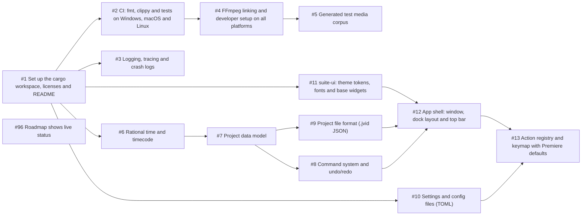
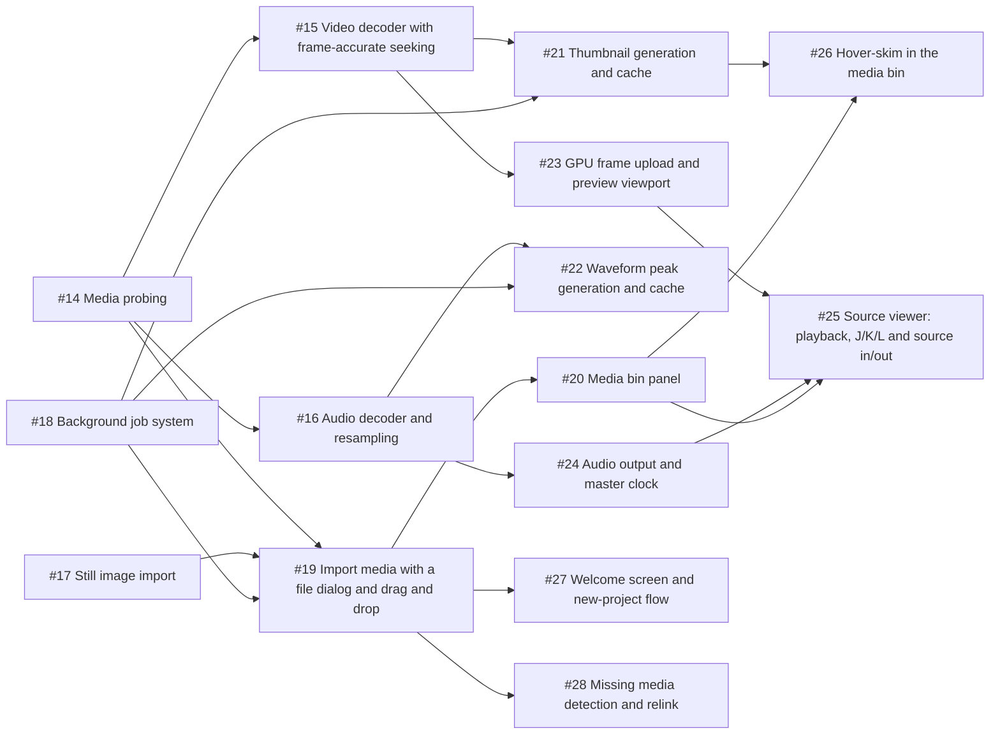
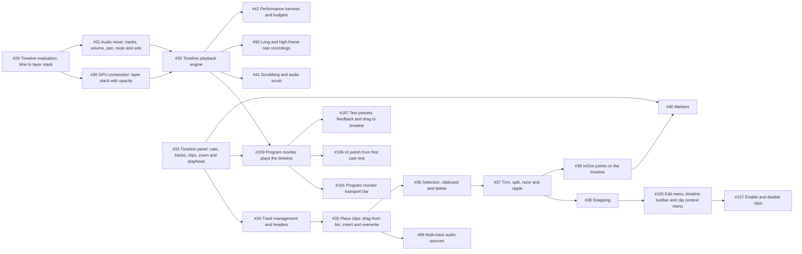
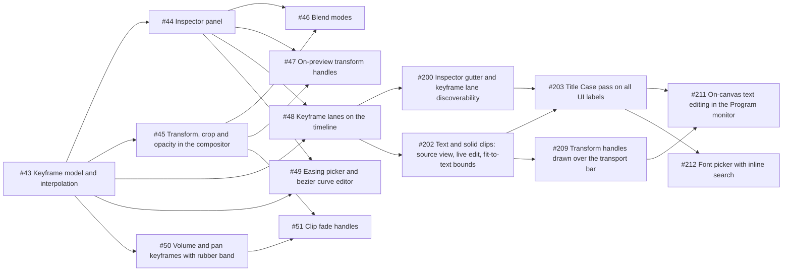
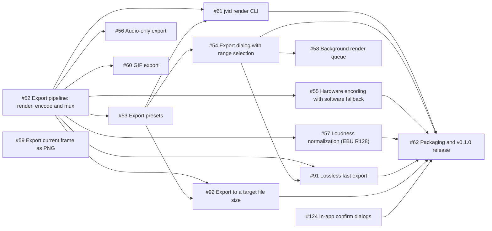
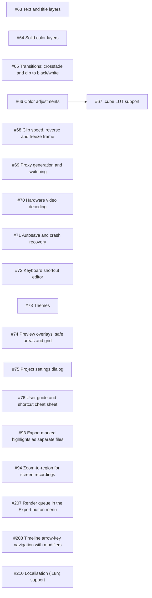
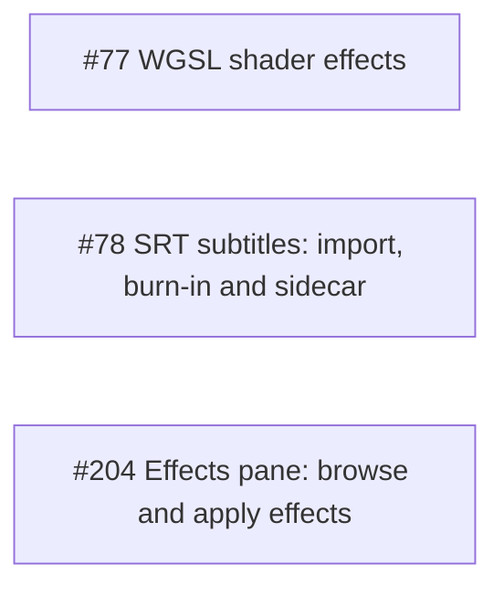

# jvid roadmap

The order jvid gets built in. Every item is a GitHub issue with scope, acceptance criteria and dependencies. The feature set and architecture behind them are in [PLAN.md](PLAN.md).

**Picking up work:** take the first open issue in the current milestone's table whose dependencies are all closed. The tables below are in build order, so issue numbers don't always follow it. Issues tagged [`good first issue`](https://github.com/jarradbanks/jvid/labels/good%20first%20issue) are self-contained.

## Releases

| Release | Milestones | What you can do |
| --- | --- | --- |
| **v0.1.0** | [M0 · Foundations](https://github.com/jarradbanks/jvid/milestone/1), [M1 · Media & Preview](https://github.com/jarradbanks/jvid/milestone/2), [M2 · Timeline](https://github.com/jarradbanks/jvid/milestone/3), [M3 · Animate](https://github.com/jarradbanks/jvid/milestone/4), [M4 · Export & v0.1.0](https://github.com/jarradbanks/jvid/milestone/5) | The first usable quick editor: import, cut, layer, animate, export. |
| **v0.2.0** | [M5 · Polish (v0.2.0)](https://github.com/jarradbanks/jvid/milestone/6) | Titles, transitions, color, speed, and the performance work that makes 4K comfortable. |
| **v0.3.0** | [M6 · Extend (v0.3.0)](https://github.com/jarradbanks/jvid/milestone/7) | Extensibility: user shader effects and subtitles. |

## How the order was chosen

1. **Biggest risks first.** FFmpeg linking on three platforms and frame-accurate decoding of long, variable-frame-rate recordings are the parts most likely to go wrong, so they land in M0 and M1.
2. **Model before UI.** Time, the project model and undo/redo exist before anything edits a project, so every feature is undoable and saveable from its first commit.
3. **Playable early.** By the end of M2 you can cut a multi-layer timeline and play it back. M3 adds animation; M4 makes it exportable and ships v0.1.0.
4. **One evaluation path.** Playback, export and the CLI all use the same timeline evaluation ([#29](https://github.com/jarradbanks/jvid/issues/29)), so what you see is what you export.
5. **Polish after usefulness.** Titles, transitions, color and proxies wait for v0.2.0; they build on the transform and keyframe work rather than shaping it.

## Critical path

The longest chain of dependent issues, about **68 person-days**. Everything else can happen alongside it.

[#1](https://github.com/jarradbanks/jvid/issues/1) Set up the cargo workspace, licenses and README → [#2](https://github.com/jarradbanks/jvid/issues/2) CI: fmt, clippy and tests on Windows, macOS and Linux → [#4](https://github.com/jarradbanks/jvid/issues/4) FFmpeg linking and developer setup on all platforms → [#5](https://github.com/jarradbanks/jvid/issues/5) Generated test media corpus → [#14](https://github.com/jarradbanks/jvid/issues/14) Media probing → [#15](https://github.com/jarradbanks/jvid/issues/15) Video decoder with frame-accurate seeking → [#21](https://github.com/jarradbanks/jvid/issues/21) Thumbnail generation and cache → [#33](https://github.com/jarradbanks/jvid/issues/33) Timeline panel: ruler, tracks, clips, zoom and playhead → [#34](https://github.com/jarradbanks/jvid/issues/34) Track management and headers → [#35](https://github.com/jarradbanks/jvid/issues/35) Place clips: drag from bin, insert and overwrite → [#36](https://github.com/jarradbanks/jvid/issues/36) Selection, clipboard and delete → [#44](https://github.com/jarradbanks/jvid/issues/44) Inspector panel → [#48](https://github.com/jarradbanks/jvid/issues/48) Keyframe lanes on the timeline → [#202](https://github.com/jarradbanks/jvid/issues/202) Text and solid clips: source view, live edit, fit-to-text bounds → [#209](https://github.com/jarradbanks/jvid/issues/209) Transform handles drawn over the transport bar → [#211](https://github.com/jarradbanks/jvid/issues/211) On-canvas text editing in the Program monitor → [#62](https://github.com/jarradbanks/jvid/issues/62) Packaging and v0.1.0 release

## Parallel tracks

After M0, work splits into tracks that rarely block each other:

| Track | Crates | Issues |
| --- | --- | --- |
| Core | `jvid-core` | [#6](https://github.com/jarradbanks/jvid/issues/6) [#7](https://github.com/jarradbanks/jvid/issues/7) [#8](https://github.com/jarradbanks/jvid/issues/8) [#9](https://github.com/jarradbanks/jvid/issues/9) [#10](https://github.com/jarradbanks/jvid/issues/10) [#18](https://github.com/jarradbanks/jvid/issues/18) [#29](https://github.com/jarradbanks/jvid/issues/29) [#43](https://github.com/jarradbanks/jvid/issues/43) [#68](https://github.com/jarradbanks/jvid/issues/68) [#71](https://github.com/jarradbanks/jvid/issues/71) |
| Media | `jvid-media` | [#4](https://github.com/jarradbanks/jvid/issues/4) [#5](https://github.com/jarradbanks/jvid/issues/5) [#14](https://github.com/jarradbanks/jvid/issues/14) [#15](https://github.com/jarradbanks/jvid/issues/15) [#16](https://github.com/jarradbanks/jvid/issues/16) [#17](https://github.com/jarradbanks/jvid/issues/17) [#19](https://github.com/jarradbanks/jvid/issues/19) [#21](https://github.com/jarradbanks/jvid/issues/21) [#28](https://github.com/jarradbanks/jvid/issues/28) [#89](https://github.com/jarradbanks/jvid/issues/89) [#90](https://github.com/jarradbanks/jvid/issues/90) [#52](https://github.com/jarradbanks/jvid/issues/52) [#55](https://github.com/jarradbanks/jvid/issues/55) [#91](https://github.com/jarradbanks/jvid/issues/91) [#69](https://github.com/jarradbanks/jvid/issues/69) [#70](https://github.com/jarradbanks/jvid/issues/70) |
| Render | `jvid-render` | [#23](https://github.com/jarradbanks/jvid/issues/23) [#30](https://github.com/jarradbanks/jvid/issues/30) [#32](https://github.com/jarradbanks/jvid/issues/32) [#157](https://github.com/jarradbanks/jvid/issues/157) [#159](https://github.com/jarradbanks/jvid/issues/159) [#41](https://github.com/jarradbanks/jvid/issues/41) [#45](https://github.com/jarradbanks/jvid/issues/45) [#46](https://github.com/jarradbanks/jvid/issues/46) [#47](https://github.com/jarradbanks/jvid/issues/47) [#63](https://github.com/jarradbanks/jvid/issues/63) [#64](https://github.com/jarradbanks/jvid/issues/64) [#65](https://github.com/jarradbanks/jvid/issues/65) [#66](https://github.com/jarradbanks/jvid/issues/66) [#67](https://github.com/jarradbanks/jvid/issues/67) [#70](https://github.com/jarradbanks/jvid/issues/70) [#94](https://github.com/jarradbanks/jvid/issues/94) [#77](https://github.com/jarradbanks/jvid/issues/77) [#78](https://github.com/jarradbanks/jvid/issues/78) [#202](https://github.com/jarradbanks/jvid/issues/202) [#211](https://github.com/jarradbanks/jvid/issues/211) |
| Audio | `jvid-audio` | [#16](https://github.com/jarradbanks/jvid/issues/16) [#22](https://github.com/jarradbanks/jvid/issues/22) [#24](https://github.com/jarradbanks/jvid/issues/24) [#31](https://github.com/jarradbanks/jvid/issues/31) [#32](https://github.com/jarradbanks/jvid/issues/32) [#50](https://github.com/jarradbanks/jvid/issues/50) [#56](https://github.com/jarradbanks/jvid/issues/56) [#57](https://github.com/jarradbanks/jvid/issues/57) |
| UI and timeline | `jvid-app`, `suite-ui` | [#11](https://github.com/jarradbanks/jvid/issues/11) [#12](https://github.com/jarradbanks/jvid/issues/12) [#13](https://github.com/jarradbanks/jvid/issues/13) [#19](https://github.com/jarradbanks/jvid/issues/19) [#20](https://github.com/jarradbanks/jvid/issues/20) [#25](https://github.com/jarradbanks/jvid/issues/25) [#26](https://github.com/jarradbanks/jvid/issues/26) [#27](https://github.com/jarradbanks/jvid/issues/27) [#28](https://github.com/jarradbanks/jvid/issues/28) [#33](https://github.com/jarradbanks/jvid/issues/33) [#34](https://github.com/jarradbanks/jvid/issues/34) [#35](https://github.com/jarradbanks/jvid/issues/35) [#89](https://github.com/jarradbanks/jvid/issues/89) [#36](https://github.com/jarradbanks/jvid/issues/36) [#37](https://github.com/jarradbanks/jvid/issues/37) [#38](https://github.com/jarradbanks/jvid/issues/38) [#155](https://github.com/jarradbanks/jvid/issues/155) [#157](https://github.com/jarradbanks/jvid/issues/157) [#159](https://github.com/jarradbanks/jvid/issues/159) [#191](https://github.com/jarradbanks/jvid/issues/191) [#196](https://github.com/jarradbanks/jvid/issues/196) [#197](https://github.com/jarradbanks/jvid/issues/197) [#39](https://github.com/jarradbanks/jvid/issues/39) [#40](https://github.com/jarradbanks/jvid/issues/40) [#41](https://github.com/jarradbanks/jvid/issues/41) [#90](https://github.com/jarradbanks/jvid/issues/90) [#44](https://github.com/jarradbanks/jvid/issues/44) [#47](https://github.com/jarradbanks/jvid/issues/47) [#48](https://github.com/jarradbanks/jvid/issues/48) [#49](https://github.com/jarradbanks/jvid/issues/49) [#50](https://github.com/jarradbanks/jvid/issues/50) [#51](https://github.com/jarradbanks/jvid/issues/51) [#54](https://github.com/jarradbanks/jvid/issues/54) [#58](https://github.com/jarradbanks/jvid/issues/58) [#63](https://github.com/jarradbanks/jvid/issues/63) [#65](https://github.com/jarradbanks/jvid/issues/65) [#68](https://github.com/jarradbanks/jvid/issues/68) [#72](https://github.com/jarradbanks/jvid/issues/72) [#73](https://github.com/jarradbanks/jvid/issues/73) [#74](https://github.com/jarradbanks/jvid/issues/74) [#75](https://github.com/jarradbanks/jvid/issues/75) [#93](https://github.com/jarradbanks/jvid/issues/93) [#94](https://github.com/jarradbanks/jvid/issues/94) [#77](https://github.com/jarradbanks/jvid/issues/77) [#200](https://github.com/jarradbanks/jvid/issues/200) [#202](https://github.com/jarradbanks/jvid/issues/202) [#203](https://github.com/jarradbanks/jvid/issues/203) [#204](https://github.com/jarradbanks/jvid/issues/204) [#207](https://github.com/jarradbanks/jvid/issues/207) [#208](https://github.com/jarradbanks/jvid/issues/208) [#209](https://github.com/jarradbanks/jvid/issues/209) [#124](https://github.com/jarradbanks/jvid/issues/124) [#210](https://github.com/jarradbanks/jvid/issues/210) [#211](https://github.com/jarradbanks/jvid/issues/211) [#212](https://github.com/jarradbanks/jvid/issues/212) |
| Export and CLI | `jvid-media`, `jvid-cli` | [#52](https://github.com/jarradbanks/jvid/issues/52) [#53](https://github.com/jarradbanks/jvid/issues/53) [#54](https://github.com/jarradbanks/jvid/issues/54) [#55](https://github.com/jarradbanks/jvid/issues/55) [#56](https://github.com/jarradbanks/jvid/issues/56) [#57](https://github.com/jarradbanks/jvid/issues/57) [#58](https://github.com/jarradbanks/jvid/issues/58) [#59](https://github.com/jarradbanks/jvid/issues/59) [#60](https://github.com/jarradbanks/jvid/issues/60) [#91](https://github.com/jarradbanks/jvid/issues/91) [#92](https://github.com/jarradbanks/jvid/issues/92) [#61](https://github.com/jarradbanks/jvid/issues/61) [#93](https://github.com/jarradbanks/jvid/issues/93) [#78](https://github.com/jarradbanks/jvid/issues/78) [#207](https://github.com/jarradbanks/jvid/issues/207) |

## Milestones

Sizes: **S** up to a day, **M** two to four days, **L** one to two weeks. Person-day totals are rough, for one developer.

### [M0 · Foundations](https://github.com/jarradbanks/jvid/milestone/1)

Workspace, CI, FFmpeg setup, project model, undo/redo, file format, app shell, theme, keymap. 14 issues, about 26 person-days.

| Issue | Title | Status | Size | Area | Depends on |
| --- | --- | --- | --- | --- | --- |
| [#1](https://github.com/jarradbanks/jvid/issues/1) | Set up the cargo workspace, licenses and README | done | S | infra | — |
| [#2](https://github.com/jarradbanks/jvid/issues/2) | CI: fmt, clippy and tests on Windows, macOS and Linux | done | S | infra | [#1](https://github.com/jarradbanks/jvid/issues/1) |
| [#3](https://github.com/jarradbanks/jvid/issues/3) | Logging, tracing and crash logs | done | S | infra | [#1](https://github.com/jarradbanks/jvid/issues/1) |
| [#96](https://github.com/jarradbanks/jvid/issues/96) | Roadmap shows live status | done | S | infra | — |
| [#4](https://github.com/jarradbanks/jvid/issues/4) | FFmpeg linking and developer setup on all platforms | done | M | infra, media | [#2](https://github.com/jarradbanks/jvid/issues/2) |
| [#5](https://github.com/jarradbanks/jvid/issues/5) | Generated test media corpus | done | S | infra, media | [#4](https://github.com/jarradbanks/jvid/issues/4) |
| [#6](https://github.com/jarradbanks/jvid/issues/6) | Rational time and timecode | done | S | core | [#1](https://github.com/jarradbanks/jvid/issues/1) |
| [#7](https://github.com/jarradbanks/jvid/issues/7) | Project data model | done | M | core | [#6](https://github.com/jarradbanks/jvid/issues/6) |
| [#8](https://github.com/jarradbanks/jvid/issues/8) | Command system and undo/redo | done | M | core | [#7](https://github.com/jarradbanks/jvid/issues/7) |
| [#9](https://github.com/jarradbanks/jvid/issues/9) | Project file format (.jvid JSON) | done | S | core | [#7](https://github.com/jarradbanks/jvid/issues/7) |
| [#10](https://github.com/jarradbanks/jvid/issues/10) | Settings and config files (TOML) | done | S | core | [#1](https://github.com/jarradbanks/jvid/issues/1) |
| [#11](https://github.com/jarradbanks/jvid/issues/11) | suite-ui: theme tokens, fonts and base widgets | need testing | M | suite-ui | [#1](https://github.com/jarradbanks/jvid/issues/1) |
| [#12](https://github.com/jarradbanks/jvid/issues/12) | App shell: window, dock layout and top bar | need testing | M | ui | [#11](https://github.com/jarradbanks/jvid/issues/11), [#9](https://github.com/jarradbanks/jvid/issues/9), [#8](https://github.com/jarradbanks/jvid/issues/8) |
| [#13](https://github.com/jarradbanks/jvid/issues/13) | Action registry and keymap with Premiere defaults | done | M | ui | [#12](https://github.com/jarradbanks/jvid/issues/12), [#10](https://github.com/jarradbanks/jvid/issues/10) |

### [M1 · Media & Preview](https://github.com/jarradbanks/jvid/milestone/2)

Probe, decode, import, media bin, thumbnails, waveforms, GPU preview, audio output, source viewer, welcome screen. 15 issues, about 49 person-days.

| Issue | Title | Status | Size | Area | Depends on |
| --- | --- | --- | --- | --- | --- |
| [#14](https://github.com/jarradbanks/jvid/issues/14) | Media probing | done | M | media | [#4](https://github.com/jarradbanks/jvid/issues/4), [#7](https://github.com/jarradbanks/jvid/issues/7), [#5](https://github.com/jarradbanks/jvid/issues/5) |
| [#15](https://github.com/jarradbanks/jvid/issues/15) | Video decoder with frame-accurate seeking | done | L | media | [#14](https://github.com/jarradbanks/jvid/issues/14) |
| [#16](https://github.com/jarradbanks/jvid/issues/16) | Audio decoder and resampling | done | M | media, audio | [#14](https://github.com/jarradbanks/jvid/issues/14) |
| [#17](https://github.com/jarradbanks/jvid/issues/17) | Still image import | done | S | media | [#7](https://github.com/jarradbanks/jvid/issues/7) |
| [#18](https://github.com/jarradbanks/jvid/issues/18) | Background job system | need testing | M | core | [#1](https://github.com/jarradbanks/jvid/issues/1) |
| [#19](https://github.com/jarradbanks/jvid/issues/19) | Import media with a file dialog and drag and drop | done | M | ui, media | [#14](https://github.com/jarradbanks/jvid/issues/14), [#17](https://github.com/jarradbanks/jvid/issues/17), [#18](https://github.com/jarradbanks/jvid/issues/18), [#12](https://github.com/jarradbanks/jvid/issues/12) |
| [#20](https://github.com/jarradbanks/jvid/issues/20) | Media bin panel | done | M | ui | [#19](https://github.com/jarradbanks/jvid/issues/19) |
| [#21](https://github.com/jarradbanks/jvid/issues/21) | Thumbnail generation and cache | done | M | media | [#15](https://github.com/jarradbanks/jvid/issues/15), [#18](https://github.com/jarradbanks/jvid/issues/18) |
| [#22](https://github.com/jarradbanks/jvid/issues/22) | Waveform peak generation and cache | done | M | audio | [#16](https://github.com/jarradbanks/jvid/issues/16), [#18](https://github.com/jarradbanks/jvid/issues/18) |
| [#23](https://github.com/jarradbanks/jvid/issues/23) | GPU frame upload and preview viewport | need testing | M | render | [#15](https://github.com/jarradbanks/jvid/issues/15), [#12](https://github.com/jarradbanks/jvid/issues/12) |
| [#24](https://github.com/jarradbanks/jvid/issues/24) | Audio output and master clock | done | M | audio | [#16](https://github.com/jarradbanks/jvid/issues/16) |
| [#25](https://github.com/jarradbanks/jvid/issues/25) | Source viewer: playback, J/K/L and source in/out | need testing | L | ui | [#23](https://github.com/jarradbanks/jvid/issues/23), [#24](https://github.com/jarradbanks/jvid/issues/24), [#13](https://github.com/jarradbanks/jvid/issues/13), [#20](https://github.com/jarradbanks/jvid/issues/20) |
| [#26](https://github.com/jarradbanks/jvid/issues/26) | Hover-skim in the media bin | done | S | ui | [#21](https://github.com/jarradbanks/jvid/issues/21), [#20](https://github.com/jarradbanks/jvid/issues/20) |
| [#27](https://github.com/jarradbanks/jvid/issues/27) | Welcome screen and new-project flow | need testing | M | ui | [#12](https://github.com/jarradbanks/jvid/issues/12), [#10](https://github.com/jarradbanks/jvid/issues/10), [#19](https://github.com/jarradbanks/jvid/issues/19) |
| [#28](https://github.com/jarradbanks/jvid/issues/28) | Missing media detection and relink | need testing | S | ui, media | [#19](https://github.com/jarradbanks/jvid/issues/19), [#9](https://github.com/jarradbanks/jvid/issues/9) |

### [M2 · Timeline](https://github.com/jarradbanks/jvid/milestone/3)

Timeline panel, tracks, clip placement, trim/split/ripple, snapping, in/out, compositor, mixer, playback. 22 issues, about 76 person-days.

| Issue | Title | Status | Size | Area | Depends on |
| --- | --- | --- | --- | --- | --- |
| [#29](https://github.com/jarradbanks/jvid/issues/29) | Timeline evaluation: time to layer stack | done | M | core | [#7](https://github.com/jarradbanks/jvid/issues/7) |
| [#30](https://github.com/jarradbanks/jvid/issues/30) | GPU compositor: layer stack with opacity | done | L | render | [#29](https://github.com/jarradbanks/jvid/issues/29), [#23](https://github.com/jarradbanks/jvid/issues/23) |
| [#31](https://github.com/jarradbanks/jvid/issues/31) | Audio mixer: tracks, volume, pan, mute and solo | done | M | audio | [#29](https://github.com/jarradbanks/jvid/issues/29), [#16](https://github.com/jarradbanks/jvid/issues/16) |
| [#32](https://github.com/jarradbanks/jvid/issues/32) | Timeline playback engine | need testing | L | render, audio | [#30](https://github.com/jarradbanks/jvid/issues/30), [#31](https://github.com/jarradbanks/jvid/issues/31), [#24](https://github.com/jarradbanks/jvid/issues/24) |
| [#33](https://github.com/jarradbanks/jvid/issues/33) | Timeline panel: ruler, tracks, clips, zoom and playhead | need testing | L | ui, timeline | [#12](https://github.com/jarradbanks/jvid/issues/12), [#7](https://github.com/jarradbanks/jvid/issues/7), [#21](https://github.com/jarradbanks/jvid/issues/21), [#22](https://github.com/jarradbanks/jvid/issues/22) |
| [#34](https://github.com/jarradbanks/jvid/issues/34) | Track management and headers | done | M | timeline | [#33](https://github.com/jarradbanks/jvid/issues/33), [#8](https://github.com/jarradbanks/jvid/issues/8) |
| [#35](https://github.com/jarradbanks/jvid/issues/35) | Place clips: drag from bin, insert and overwrite | done | M | timeline | [#34](https://github.com/jarradbanks/jvid/issues/34), [#25](https://github.com/jarradbanks/jvid/issues/25) |
| [#89](https://github.com/jarradbanks/jvid/issues/89) | Multi-track audio sources | done | M | timeline, media | [#35](https://github.com/jarradbanks/jvid/issues/35), [#16](https://github.com/jarradbanks/jvid/issues/16) |
| [#36](https://github.com/jarradbanks/jvid/issues/36) | Selection, clipboard and delete | done | M | timeline | [#35](https://github.com/jarradbanks/jvid/issues/35) |
| [#37](https://github.com/jarradbanks/jvid/issues/37) | Trim, split, razor and ripple | done | L | timeline | [#36](https://github.com/jarradbanks/jvid/issues/36) |
| [#38](https://github.com/jarradbanks/jvid/issues/38) | Snapping | done | S | timeline | [#37](https://github.com/jarradbanks/jvid/issues/37) |
| [#155](https://github.com/jarradbanks/jvid/issues/155) | Edit menu, timeline toolbar and clip context menu | done | M | ui, timeline | [#38](https://github.com/jarradbanks/jvid/issues/38) |
| [#157](https://github.com/jarradbanks/jvid/issues/157) | Enable and disable clips | done | S | timeline, render | [#155](https://github.com/jarradbanks/jvid/issues/155) |
| [#159](https://github.com/jarradbanks/jvid/issues/159) | Program monitor plays the timeline | need testing | M | ui, render | [#32](https://github.com/jarradbanks/jvid/issues/32), [#33](https://github.com/jarradbanks/jvid/issues/33) |
| [#191](https://github.com/jarradbanks/jvid/issues/191) | Program monitor transport bar | done | S | ui | [#159](https://github.com/jarradbanks/jvid/issues/159) |
| [#196](https://github.com/jarradbanks/jvid/issues/196) | UI polish from first user test | done | S | ui | [#159](https://github.com/jarradbanks/jvid/issues/159) |
| [#197](https://github.com/jarradbanks/jvid/issues/197) | Text presets: feedback and drag to timeline | done | S | ui, timeline | [#159](https://github.com/jarradbanks/jvid/issues/159) |
| [#39](https://github.com/jarradbanks/jvid/issues/39) | In/Out points on the timeline | done | M | timeline | [#37](https://github.com/jarradbanks/jvid/issues/37), [#13](https://github.com/jarradbanks/jvid/issues/13) |
| [#40](https://github.com/jarradbanks/jvid/issues/40) | Markers | done | M | timeline | [#33](https://github.com/jarradbanks/jvid/issues/33), [#8](https://github.com/jarradbanks/jvid/issues/8), [#39](https://github.com/jarradbanks/jvid/issues/39) |
| [#41](https://github.com/jarradbanks/jvid/issues/41) | Scrubbing and audio scrub | done | M | timeline, render | [#32](https://github.com/jarradbanks/jvid/issues/32) |
| [#90](https://github.com/jarradbanks/jvid/issues/90) | Long and high-frame-rate recordings | done | M | media, timeline | [#32](https://github.com/jarradbanks/jvid/issues/32), [#21](https://github.com/jarradbanks/jvid/issues/21), [#22](https://github.com/jarradbanks/jvid/issues/22) |
| [#42](https://github.com/jarradbanks/jvid/issues/42) | Performance harness and budgets | done | M | infra | [#32](https://github.com/jarradbanks/jvid/issues/32) |

### [M3 · Animate](https://github.com/jarradbanks/jvid/milestone/4)

Keyframes with easing, inspector, transform/crop/opacity/blend, preview gizmo, keyframe lanes, audio automation. 15 issues, about 43 person-days.

| Issue | Title | Status | Size | Area | Depends on |
| --- | --- | --- | --- | --- | --- |
| [#43](https://github.com/jarradbanks/jvid/issues/43) | Keyframe model and interpolation | done | M | core | [#7](https://github.com/jarradbanks/jvid/issues/7), [#8](https://github.com/jarradbanks/jvid/issues/8) |
| [#44](https://github.com/jarradbanks/jvid/issues/44) | Inspector panel | done | L | ui | [#12](https://github.com/jarradbanks/jvid/issues/12), [#43](https://github.com/jarradbanks/jvid/issues/43), [#36](https://github.com/jarradbanks/jvid/issues/36) |
| [#45](https://github.com/jarradbanks/jvid/issues/45) | Transform, crop and opacity in the compositor | done | M | render | [#30](https://github.com/jarradbanks/jvid/issues/30), [#43](https://github.com/jarradbanks/jvid/issues/43) |
| [#46](https://github.com/jarradbanks/jvid/issues/46) | Blend modes | done | S | render | [#45](https://github.com/jarradbanks/jvid/issues/45), [#44](https://github.com/jarradbanks/jvid/issues/44) |
| [#47](https://github.com/jarradbanks/jvid/issues/47) | On-preview transform handles | done | M | ui, render | [#45](https://github.com/jarradbanks/jvid/issues/45), [#44](https://github.com/jarradbanks/jvid/issues/44) |
| [#48](https://github.com/jarradbanks/jvid/issues/48) | Keyframe lanes on the timeline | done | L | timeline | [#43](https://github.com/jarradbanks/jvid/issues/43), [#33](https://github.com/jarradbanks/jvid/issues/33), [#44](https://github.com/jarradbanks/jvid/issues/44) |
| [#49](https://github.com/jarradbanks/jvid/issues/49) | Easing picker and bezier curve editor | done | M | ui | [#43](https://github.com/jarradbanks/jvid/issues/43), [#44](https://github.com/jarradbanks/jvid/issues/44) |
| [#50](https://github.com/jarradbanks/jvid/issues/50) | Volume and pan keyframes with rubber band | done | M | audio, timeline | [#43](https://github.com/jarradbanks/jvid/issues/43), [#31](https://github.com/jarradbanks/jvid/issues/31), [#33](https://github.com/jarradbanks/jvid/issues/33) |
| [#51](https://github.com/jarradbanks/jvid/issues/51) | Clip fade handles | done | S | timeline | [#50](https://github.com/jarradbanks/jvid/issues/50), [#45](https://github.com/jarradbanks/jvid/issues/45) |
| [#200](https://github.com/jarradbanks/jvid/issues/200) | Inspector gutter and keyframe lane discoverability | need testing | S | ui, timeline | [#48](https://github.com/jarradbanks/jvid/issues/48) |
| [#202](https://github.com/jarradbanks/jvid/issues/202) | Text and solid clips: source view, live edit, fit-to-text bounds | done | M | ui, render | [#48](https://github.com/jarradbanks/jvid/issues/48) |
| [#203](https://github.com/jarradbanks/jvid/issues/203) | Title Case pass on all UI labels | need testing | S | ui, suite-ui | [#202](https://github.com/jarradbanks/jvid/issues/202), [#200](https://github.com/jarradbanks/jvid/issues/200) |
| [#209](https://github.com/jarradbanks/jvid/issues/209) | Transform handles drawn over the transport bar | need testing | S | ui | [#202](https://github.com/jarradbanks/jvid/issues/202) |
| [#211](https://github.com/jarradbanks/jvid/issues/211) | On-canvas text editing in the Program monitor | need testing | M | ui, render | [#209](https://github.com/jarradbanks/jvid/issues/209), [#203](https://github.com/jarradbanks/jvid/issues/203) |
| [#212](https://github.com/jarradbanks/jvid/issues/212) | Font picker with inline search | need testing | S | ui | [#203](https://github.com/jarradbanks/jvid/issues/203) |

### [M4 · Export & v0.1.0](https://github.com/jarradbanks/jvid/milestone/5)

Export pipeline, presets, export dialog with In to Out, hardware encode, loudness, queue, CLI render, release packaging. 14 issues, about 51 person-days.

| Issue | Title | Status | Size | Area | Depends on |
| --- | --- | --- | --- | --- | --- |
| [#52](https://github.com/jarradbanks/jvid/issues/52) | Export pipeline: render, encode and mux | done | L | export, media | [#30](https://github.com/jarradbanks/jvid/issues/30), [#31](https://github.com/jarradbanks/jvid/issues/31), [#45](https://github.com/jarradbanks/jvid/issues/45) |
| [#53](https://github.com/jarradbanks/jvid/issues/53) | Export presets | done | M | export | [#52](https://github.com/jarradbanks/jvid/issues/52) |
| [#54](https://github.com/jarradbanks/jvid/issues/54) | Export dialog with range selection | done | M | ui, export | [#53](https://github.com/jarradbanks/jvid/issues/53), [#39](https://github.com/jarradbanks/jvid/issues/39), [#36](https://github.com/jarradbanks/jvid/issues/36) |
| [#55](https://github.com/jarradbanks/jvid/issues/55) | Hardware encoding with software fallback | need testing | M | export, media | [#52](https://github.com/jarradbanks/jvid/issues/52) |
| [#56](https://github.com/jarradbanks/jvid/issues/56) | Audio-only export | done | S | export, audio | [#52](https://github.com/jarradbanks/jvid/issues/52) |
| [#57](https://github.com/jarradbanks/jvid/issues/57) | Loudness normalization (EBU R128) | done | M | audio, export | [#52](https://github.com/jarradbanks/jvid/issues/52) |
| [#58](https://github.com/jarradbanks/jvid/issues/58) | Background render queue | done | M | export, ui | [#54](https://github.com/jarradbanks/jvid/issues/54), [#18](https://github.com/jarradbanks/jvid/issues/18) |
| [#59](https://github.com/jarradbanks/jvid/issues/59) | Export current frame as PNG | done | S | export | [#30](https://github.com/jarradbanks/jvid/issues/30) |
| [#60](https://github.com/jarradbanks/jvid/issues/60) | GIF export | done | S | export | [#52](https://github.com/jarradbanks/jvid/issues/52) |
| [#91](https://github.com/jarradbanks/jvid/issues/91) | Lossless fast export | need testing | L | export, media | [#52](https://github.com/jarradbanks/jvid/issues/52), [#54](https://github.com/jarradbanks/jvid/issues/54) |
| [#92](https://github.com/jarradbanks/jvid/issues/92) | Export to a target file size | done | M | export | [#52](https://github.com/jarradbanks/jvid/issues/52), [#53](https://github.com/jarradbanks/jvid/issues/53) |
| [#61](https://github.com/jarradbanks/jvid/issues/61) | jvid render CLI | done | M | cli | [#52](https://github.com/jarradbanks/jvid/issues/52), [#53](https://github.com/jarradbanks/jvid/issues/53), [#9](https://github.com/jarradbanks/jvid/issues/9) |
| [#124](https://github.com/jarradbanks/jvid/issues/124) | In-app confirm dialogs | need testing | M | ui, suite-ui | [#203](https://github.com/jarradbanks/jvid/issues/203) |
| [#62](https://github.com/jarradbanks/jvid/issues/62) | Packaging and v0.1.0 release |  | L | infra | [#61](https://github.com/jarradbanks/jvid/issues/61), [#54](https://github.com/jarradbanks/jvid/issues/54), [#55](https://github.com/jarradbanks/jvid/issues/55), [#57](https://github.com/jarradbanks/jvid/issues/57), [#91](https://github.com/jarradbanks/jvid/issues/91), [#92](https://github.com/jarradbanks/jvid/issues/92), [#203](https://github.com/jarradbanks/jvid/issues/203), [#209](https://github.com/jarradbanks/jvid/issues/209), [#211](https://github.com/jarradbanks/jvid/issues/211), [#212](https://github.com/jarradbanks/jvid/issues/212), [#124](https://github.com/jarradbanks/jvid/issues/124), [#204](https://github.com/jarradbanks/jvid/issues/204), [#207](https://github.com/jarradbanks/jvid/issues/207), [#208](https://github.com/jarradbanks/jvid/issues/208) |

### [M5 · Polish (v0.2.0)](https://github.com/jarradbanks/jvid/milestone/6)

Text, transitions, color and LUTs, speed, proxies, hardware decode, autosave, keymap editor, themes. 19 issues, about 53 person-days.

| Issue | Title | Status | Size | Area | Depends on |
| --- | --- | --- | --- | --- | --- |
| [#63](https://github.com/jarradbanks/jvid/issues/63) | Text and title layers | done | L | render, ui | [#45](https://github.com/jarradbanks/jvid/issues/45), [#44](https://github.com/jarradbanks/jvid/issues/44), [#20](https://github.com/jarradbanks/jvid/issues/20) |
| [#64](https://github.com/jarradbanks/jvid/issues/64) | Solid color layers | done | S | render | [#45](https://github.com/jarradbanks/jvid/issues/45) |
| [#65](https://github.com/jarradbanks/jvid/issues/65) | Transitions: crossfade and dip to black/white | done | M | timeline, render | [#43](https://github.com/jarradbanks/jvid/issues/43), [#45](https://github.com/jarradbanks/jvid/issues/45), [#50](https://github.com/jarradbanks/jvid/issues/50) |
| [#66](https://github.com/jarradbanks/jvid/issues/66) | Color adjustments | done | M | render | [#45](https://github.com/jarradbanks/jvid/issues/45), [#44](https://github.com/jarradbanks/jvid/issues/44) |
| [#67](https://github.com/jarradbanks/jvid/issues/67) | .cube LUT support | done | S | render | [#66](https://github.com/jarradbanks/jvid/issues/66) |
| [#68](https://github.com/jarradbanks/jvid/issues/68) | Clip speed, reverse and freeze frame | done | M | core, timeline | [#29](https://github.com/jarradbanks/jvid/issues/29), [#37](https://github.com/jarradbanks/jvid/issues/37), [#31](https://github.com/jarradbanks/jvid/issues/31) |
| [#69](https://github.com/jarradbanks/jvid/issues/69) | Proxy generation and switching | done | M | media | [#18](https://github.com/jarradbanks/jvid/issues/18), [#15](https://github.com/jarradbanks/jvid/issues/15) |
| [#70](https://github.com/jarradbanks/jvid/issues/70) | Hardware video decoding | need testing | L | media, render | [#15](https://github.com/jarradbanks/jvid/issues/15), [#23](https://github.com/jarradbanks/jvid/issues/23) |
| [#71](https://github.com/jarradbanks/jvid/issues/71) | Autosave and crash recovery | done | M | core | [#9](https://github.com/jarradbanks/jvid/issues/9), [#3](https://github.com/jarradbanks/jvid/issues/3) |
| [#72](https://github.com/jarradbanks/jvid/issues/72) | Keyboard shortcut editor | done | M | ui | [#13](https://github.com/jarradbanks/jvid/issues/13) |
| [#73](https://github.com/jarradbanks/jvid/issues/73) | Themes | done | S | suite-ui | [#11](https://github.com/jarradbanks/jvid/issues/11) |
| [#74](https://github.com/jarradbanks/jvid/issues/74) | Preview overlays: safe areas and grid | done | S | ui | [#23](https://github.com/jarradbanks/jvid/issues/23) |
| [#75](https://github.com/jarradbanks/jvid/issues/75) | Project settings dialog | done | S | ui | [#27](https://github.com/jarradbanks/jvid/issues/27) |
| [#76](https://github.com/jarradbanks/jvid/issues/76) | User guide and shortcut cheat sheet | done | M | docs | [#54](https://github.com/jarradbanks/jvid/issues/54) |
| [#93](https://github.com/jarradbanks/jvid/issues/93) | Export marked highlights as separate files | need testing | M | export, timeline | [#40](https://github.com/jarradbanks/jvid/issues/40), [#58](https://github.com/jarradbanks/jvid/issues/58) |
| [#94](https://github.com/jarradbanks/jvid/issues/94) | Zoom-to-region for screen recordings | done | M | ui, render | [#47](https://github.com/jarradbanks/jvid/issues/47), [#43](https://github.com/jarradbanks/jvid/issues/43), [#49](https://github.com/jarradbanks/jvid/issues/49) |
| [#207](https://github.com/jarradbanks/jvid/issues/207) | Render queue in the Export button menu | need testing | S | ui, export | [#203](https://github.com/jarradbanks/jvid/issues/203) |
| [#208](https://github.com/jarradbanks/jvid/issues/208) | Timeline arrow-key navigation with modifiers | need testing | S | ui, timeline | [#203](https://github.com/jarradbanks/jvid/issues/203) |
| [#210](https://github.com/jarradbanks/jvid/issues/210) | Localisation (i18n) support | need testing | M | ui, suite-ui | [#124](https://github.com/jarradbanks/jvid/issues/124), [#203](https://github.com/jarradbanks/jvid/issues/203) |

### [M6 · Extend (v0.3.0)](https://github.com/jarradbanks/jvid/milestone/7)

WGSL shader effects and SRT subtitles. 3 issues, about 14 person-days.

| Issue | Title | Status | Size | Area | Depends on |
| --- | --- | --- | --- | --- | --- |
| [#77](https://github.com/jarradbanks/jvid/issues/77) | WGSL shader effects | done | L | render, ui | [#66](https://github.com/jarradbanks/jvid/issues/66), [#44](https://github.com/jarradbanks/jvid/issues/44), [#43](https://github.com/jarradbanks/jvid/issues/43) |
| [#78](https://github.com/jarradbanks/jvid/issues/78) | SRT subtitles: import, burn-in and sidecar | need testing | M | export, render | [#63](https://github.com/jarradbanks/jvid/issues/63), [#52](https://github.com/jarradbanks/jvid/issues/52) |
| [#204](https://github.com/jarradbanks/jvid/issues/204) | Effects pane: browse and apply effects | need testing | M | ui | [#203](https://github.com/jarradbanks/jvid/issues/203) |

## Later

Planned after v0.3.0, or better suited to plugins. Tracked with the [`later`](https://github.com/jarradbanks/jvid/labels/later) label.

- [#169](https://github.com/jarradbanks/jvid/issues/169) **VAAPI hardware encoding on Linux** — Hardware H.264/HEVC export on Linux via VAAPI.
- [#228](https://github.com/jarradbanks/jvid/issues/228) **Move application settings to Edit > Preferences** — Make application preferences discoverable under Edit > Preferences instead of the title-bar project menu.
- [#229](https://github.com/jarradbanks/jvid/issues/229) **Create a track when dropping assets outside existing tracks** — Dropping text, solids or other assets into empty timeline space should create a track above the existing one.
- [#230](https://github.com/jarradbanks/jvid/issues/230) **Snap timeline In/Out flags to clip starts and ends** — The timeline In/Out flags currently do not snap to clip boundaries when dragged.
- [#231](https://github.com/jarradbanks/jvid/issues/231) **Inspector rows: one diamond, reset on change, sliders** — Inspector rows are noisy and mostly empty: every row ends in the same reset and keyframe icons far from its value. Tidy them so values, changes and keyframes read at a glance.
- [#232](https://github.com/jarradbanks/jvid/issues/232) **Inspector effect stack: blocks, bypass, reorder, Add Effect menu** — Effects in the Inspector are bare labels with Up, Down and Remove text buttons that appear and vanish, and Add Effect is a dropdown. Make each effect a block you can collapse, bypass and reorder.
- [#233](https://github.com/jarradbanks/jvid/issues/233) **Inspector tabs: Video, Audio and Effects** — Split the Inspector into tabs so each one is short and effects are one click away (option B in the mockup).
- [#234](https://github.com/jarradbanks/jvid/issues/234) **Thumbnail frame from the Program view** — Effect and text thumbnails need a picture to draw on: use the Program frame at the playhead, with a bundled fallback.
- [#235](https://github.com/jarradbanks/jvid/issues/235) **Effects tab thumbnails and a row layout that never shifts** — In the Effects tab, hovering draws Apply over the description, and nothing shows what an effect does. Add thumbnails and fixed columns.
- [#236](https://github.com/jarradbanks/jvid/issues/236) **Text tab preset tiles** — The Text tab is three plain buttons with no hint of what each makes. Show each preset on the current frame.
- [#79](https://github.com/jarradbanks/jvid/issues/79) **Chroma key** — Green and blue screen keying with spill suppression.
- [#80](https://github.com/jarradbanks/jvid/issues/80) **Masks** — Rectangle, ellipse and bezier masks with feather, animatable.
- [#81](https://github.com/jarradbanks/jvid/issues/81) **Video scopes** — Waveform, vectorscope and histogram.
- [#82](https://github.com/jarradbanks/jvid/issues/82) **Speed ramps** — Keyframed speed with smooth ramps.
- [#83](https://github.com/jarradbanks/jvid/issues/83) **Nested sequences** — Use a sequence as a clip in another sequence.
- [#84](https://github.com/jarradbanks/jvid/issues/84) **Voiceover recording** — Record from a microphone straight onto an audio track.
- [#85](https://github.com/jarradbanks/jvid/issues/85) **Audio EQ and compressor** — Basic per-clip and per-track audio effects.
- [#86](https://github.com/jarradbanks/jvid/issues/86) **HDR support** — PQ/HLG sources, tone mapping and HDR export.
- [#87](https://github.com/jarradbanks/jvid/issues/87) **Curve graph editor** — A full graph editor for keyframe curves.
- [#95](https://github.com/jarradbanks/jvid/issues/95) **Silence detection to cut dead air** — Find silent stretches in screen recordings and offer to cut or speed them up.
- [#257](https://github.com/jarradbanks/jvid/issues/257) **Preferences redesign: sections and dropdowns that fit** — The Preferences dialog is a small box whose Input Device list spills past it and over Done. Redesign it with the impeccable skill, starting from an HTML mockup like the v3 Inspector one.
- [#258](https://github.com/jarradbanks/jvid/issues/258) **Theme picker in Preferences** — Themes work (built-in Dark, Light and High Contrast, TOML files, live reload), but only by editing the settings file. Add them to Preferences with a few good defaults.
- [#259](https://github.com/jarradbanks/jvid/issues/259) **Text tab layout cleanup** — The Text tab is a ragged list: a narrow one-line text box, Size and Weight sharing a row, an unlabelled Left/Center/Right row, and colour swatches that render as odd half-checker squares. Bring it up to the Inspector row standard.
- [#260](https://github.com/jarradbanks/jvid/issues/260) **Transport bar: vertical centring check** — The Program transport bar may sit off-centre vertically: the timecodes, transport buttons, grid toggle, Preview checkbox and Full/Fit dropdowns may not share one centre line.
- [#261](https://github.com/jarradbanks/jvid/issues/261) **Export dialog and Render Queue visual upgrade** — The Export button's queue menu is a bare list (file name, Done, Reveal, then New Export, Cancel All and Clear Finished as text buttons), and the Export dialog needs the same impeccable polish. Owner picked queue option C and dialog option A of the v4 export mockup.
- [#262](https://github.com/jarradbanks/jvid/issues/262) **Drop above the top track to create a track there** — Making a new track for a title or solid means dragging it into the empty space below every track, though it usually belongs on top. Open a slot above the top track while dragging there.
- [#263](https://github.com/jarradbanks/jvid/issues/263) **Graphic EQ with presets** — The EQ is seven rows of sliders (Low, Low Freq, Mid, Mid Freq, Mid Q, High, High Freq). Editors and players use a horizontal graphic EQ; build one, with presets.
- [#264](https://github.com/jarradbanks/jvid/issues/264) **Locked tracks: no drag ghost for clips that can't move** — Dragging a clip on a locked track draws the full move ghost, then nothing moves.
- [#265](https://github.com/jarradbanks/jvid/issues/265) **Record button in the transport bar** — Voiceover only starts by arming a track in its header and pressing Shift+R, which nothing on screen explains. Add a Record button next to the play controls, as other editors have.
- [#266](https://github.com/jarradbanks/jvid/issues/266) **Impeccable polish pass on the remaining panels** — Bring every panel not covered by the issues above to the same finish, using the impeccable skill's critique and audit.
- [#274](https://github.com/jarradbanks/jvid/issues/274) **Main CI green on Windows and macOS** — Main's full matrix fails off Linux: three kittest snapshots differ on Windows WARP (bin_effects_hover, editor_light, preferences), and macOS playback::tests::loop_wraps_without_dropping_frames is timing-flaky. PRs only run Ubuntu, so it goes unseen.
- [#277](https://github.com/jarradbanks/jvid/issues/277) **Main CI: Windows record test file lock, macOS slow-decoder flake** — After #275, main run 40062193057 still fails off Linux: on Windows, record_button_records_into_a_new_armed_track_and_shift_r_stops_it (#276) panics at its final remove_dir_all with os error 32 because the recorded file is still open; on macOS, playback::tests::slow_decoder_drops_frames_instead_of_drifting is wall-clock flaky like the loop test #275 fixed.
- [#279](https://github.com/jarradbanks/jvid/issues/279) **Translation wave 1 foundation: 17 languages, plural rules, fonts** — Register the wave-1 languages so each translation lands as its own catalog files without touching shared code: fr, de, it, pt-BR, nl, pl, cs, tr, ru, uk, sv, da, nb, ca, ja, zh-Hans, ko.
- [#292](https://github.com/jarradbanks/jvid/issues/292) **Translate jvid into French** — Fill the French (fr) catalogs registered by the wave-1 foundation, accurately and consistently with what French-speaking editors see in DaVinci Resolve and Premiere Pro.
- [#293](https://github.com/jarradbanks/jvid/issues/293) **Translate jvid into German** — Fill the German (de) catalogs registered by the wave-1 foundation, accurately and consistently with what German-speaking editors see in DaVinci Resolve and Premiere Pro.
- [#294](https://github.com/jarradbanks/jvid/issues/294) **Translate jvid into Italian** — Fill the Italian (it) catalogs registered by the wave-1 foundation, accurately and consistently with what Italian-speaking editors see in DaVinci Resolve and Premiere Pro.
- [#295](https://github.com/jarradbanks/jvid/issues/295) **Translate jvid into Portuguese (Brazil)** — Fill the Portuguese (Brazil) (pt-BR) catalogs registered by the wave-1 foundation, accurately and consistently with what Portuguese (Brazil)-speaking editors see in DaVinci Resolve and Premiere Pro.
- [#296](https://github.com/jarradbanks/jvid/issues/296) **Translate jvid into Dutch** — Fill the Dutch (nl) catalogs registered by the wave-1 foundation, accurately and consistently with what Dutch-speaking editors see in DaVinci Resolve and Premiere Pro.
- [#280](https://github.com/jarradbanks/jvid/issues/280) **Translate jvid into Polish** — Fill the Polish (pl) catalogs registered by the wave-1 foundation, accurately and consistently with what Polish-speaking editors see in DaVinci Resolve and Premiere Pro.
- [#281](https://github.com/jarradbanks/jvid/issues/281) **Translate jvid into Czech** — Fill the Czech (cs) catalogs registered by the wave-1 foundation, accurately and consistently with what Czech-speaking editors see in DaVinci Resolve and Premiere Pro.
- [#282](https://github.com/jarradbanks/jvid/issues/282) **Translate jvid into Turkish** — Fill the Turkish (tr) catalogs registered by the wave-1 foundation, accurately and consistently with what Turkish-speaking editors see in DaVinci Resolve and Premiere Pro.
- [#283](https://github.com/jarradbanks/jvid/issues/283) **Translate jvid into Russian** — Fill the Russian (ru) catalogs registered by the wave-1 foundation, accurately and consistently with what Russian-speaking editors see in DaVinci Resolve and Premiere Pro.
- [#284](https://github.com/jarradbanks/jvid/issues/284) **Translate jvid into Ukrainian** — Fill the Ukrainian (uk) catalogs registered by the wave-1 foundation, accurately and consistently with what Ukrainian-speaking editors see in DaVinci Resolve and Premiere Pro.
- [#285](https://github.com/jarradbanks/jvid/issues/285) **Translate jvid into Swedish** — Fill the Swedish (sv) catalogs registered by the wave-1 foundation, accurately and consistently with what Swedish-speaking editors see in DaVinci Resolve and Premiere Pro.
- [#286](https://github.com/jarradbanks/jvid/issues/286) **Translate jvid into Danish** — Fill the Danish (da) catalogs registered by the wave-1 foundation, accurately and consistently with what Danish-speaking editors see in DaVinci Resolve and Premiere Pro.
- [#287](https://github.com/jarradbanks/jvid/issues/287) **Translate jvid into Norwegian Bokmål** — Fill the Norwegian Bokmål (nb) catalogs registered by the wave-1 foundation, accurately and consistently with what Norwegian Bokmål-speaking editors see in DaVinci Resolve and Premiere Pro.
- [#288](https://github.com/jarradbanks/jvid/issues/288) **Translate jvid into Catalan** — Fill the Catalan (ca) catalogs registered by the wave-1 foundation, accurately and consistently with what Catalan-speaking editors see in DaVinci Resolve and Premiere Pro.
- [#289](https://github.com/jarradbanks/jvid/issues/289) **Translate jvid into Japanese** — Fill the Japanese (ja) catalogs registered by the wave-1 foundation, accurately and consistently with what Japanese-speaking editors see in DaVinci Resolve and Premiere Pro.
- [#290](https://github.com/jarradbanks/jvid/issues/290) **Translate jvid into Chinese (Simplified)** — Fill the Chinese (Simplified) (zh-Hans) catalogs registered by the wave-1 foundation, accurately and consistently with what Chinese (Simplified)-speaking editors see in DaVinci Resolve and Premiere Pro.
- [#291](https://github.com/jarradbanks/jvid/issues/291) **Translate jvid into Korean** — Fill the Korean (ko) catalogs registered by the wave-1 foundation, accurately and consistently with what Korean-speaking editors see in DaVinci Resolve and Premiere Pro.
- [#298](https://github.com/jarradbanks/jvid/issues/298) **Playback tests: no wall-clock waits left** — #275 and #277 made two playback tests stepped; others still poll with Instant::now() and fail under CI load, e.g. failed_decodes_retry_and_relink_redecodes ('never shown with 1 layers', PR #297 run 40068128664).
- [#309](https://github.com/jarradbanks/jvid/issues/309) **Translation-only PRs skip the 11-minute CI** — Owner, 2026-10-24: a PR that only changes translation catalogs should not wait on the full build and GPU test suite. A seconds-long check covers what a catalog change can break.
- [#310](https://github.com/jarradbanks/jvid/issues/310) **UI handles long translated text** — Owner, 2026-10-24: text that is too long is a UI problem, not a translation one. Translators should translate naturally and the layout should cope, as in other editors.
- [#322](https://github.com/jarradbanks/jvid/issues/322) **README: real UI preview video and current pitch** — Owner, 2026-10-24: the README still leads with the AI-generated prototype and 'first tool in a planned suite'. Replace both with a short, professional, minimal motion preview made from the real UI, and copy that matches what jvid does today.
- [#323](https://github.com/jarradbanks/jvid/issues/323) **Translation leftovers found in wave 1** — Gaps the wave-1 translators found that sit in code, not catalogs (PRs #301, #302).
- [#325](https://github.com/jarradbanks/jvid/issues/325) **Preview stops decoding video from audio-only files** — Owner, 2026-10-24, Windows: 246 'preview decode of D:\fishing\media\Voiceover 2.wav failed: Stream not found' warnings in one two-minute session. The audio played fine; the preview asks the decode pool for a video frame from a WAV on every new time (crates/jvid-app/src/preview.rs around line 745) and logs each failure.
- [#326](https://github.com/jarradbanks/jvid/issues/326) **Voiceover take grows on the timeline as it records** — Owner, 2026-10-24: while a voiceover records, the timeline should show it happening, as other editors do. Today the take only lands as a clip when recording stops; until then the track header shows an input level.
- [#327](https://github.com/jarradbanks/jvid/issues/327) **Inspector tabs fill the header width** — Owner, 2026-10-24: the Inspector's tabs stop at 160px each and leave the right of the header empty; they should share the full width evenly, as the Media panel's tabs do (Panel::wide, crates/jvid-app/src/media_bin.rs).
- [#330](https://github.com/jarradbanks/jvid/issues/330) **Highlights from point markers** — Tap M when something happens, then export a clip around it: point markers count as highlights.
- [#331](https://github.com/jarradbanks/jvid/issues/331) **Hold M to mark a range while playing** — The press-and-release ranged marker from the Markers issue (#40), which shipped without it.
- [#333](https://github.com/jarradbanks/jvid/issues/333) **Interactive tutorials: lesson engine and Tutorials menu** — Hands-on lessons that run inside the real editor on sample footage, one checked step at a time.
- [#334](https://github.com/jarradbanks/jvid/issues/334) **Sample media for tutorials** — A few short, freely licensed clips installed with the app so every lesson works offline.
- [#335](https://github.com/jarradbanks/jvid/issues/335) **Tour: your first edit** — The first-launch tour, done hands-on with the sample footage.
- [#336](https://github.com/jarradbanks/jvid/issues/336) **Lesson: masks** — Learn masks by spotlighting a subject: darken everything but them, then make the mask follow them.
- [#337](https://github.com/jarradbanks/jvid/issues/337) **Lesson: keyframes and easing** — Animate a title in and learn keys, easing and the graph editor.
- [#338](https://github.com/jarradbanks/jvid/issues/338) **Lesson: colour and scopes** — Fix a dark, too-warm shot by reading the scopes, then apply a look.
- [#339](https://github.com/jarradbanks/jvid/issues/339) **Lesson: green screen** — Key the green-screen sample over a background.
- [#340](https://github.com/jarradbanks/jvid/issues/340) **Lesson: screen recordings** — Tidy a screen recording: cut dead air, zoom into the important part, add a callout.
- [#341](https://github.com/jarradbanks/jvid/issues/341) **Lesson: audio** — Balance a voice over music, duck the music and record a voiceover.
- [#342](https://github.com/jarradbanks/jvid/issues/342) **Speech-to-text engine** — Local, offline transcription with word timings, the base for auto subtitles.
- [#343](https://github.com/jarradbanks/jvid/issues/343) **Generate Subtitles** — Turn speech into editable subtitles in one click.
- [#344](https://github.com/jarradbanks/jvid/issues/344) **Edit by text** — Cut video by editing its transcript: delete words and the matching video goes with them.
- [#345](https://github.com/jarradbanks/jvid/issues/345) **Remove filler words and long pauses** — One pass that finds um, uh and dead air and cuts them out.
- [#346](https://github.com/jarradbanks/jvid/issues/346) **Voice cleanup: noise reduction and a voice preset** — Clean up a mic recording in one click.
- [#347](https://github.com/jarradbanks/jvid/issues/347) **Find Highlights in long recordings** — Scan a long recording for loud moments and scene changes and mark them.
- [#348](https://github.com/jarradbanks/jvid/issues/348) **Colour wheels: lift, gamma, gain and offset** — Primary colour wheels, copy and paste of a grade, and a skin-tone line on the vectorscope.
- [#349](https://github.com/jarradbanks/jvid/issues/349) **Curves: RGB, luma and hue curves** — Curve grading: master, R, G and B curves plus Hue vs Sat, Hue vs Hue and Luma vs Sat.
- [#350](https://github.com/jarradbanks/jvid/issues/350) **Secondary grading and grade compare** — Grade only one colour range, and compare before and after.
- [#351](https://github.com/jarradbanks/jvid/issues/351) **Blur and Pixelate effects** — Hide emails, keys and faces in recordings.
- [#352](https://github.com/jarradbanks/jvid/issues/352) **Reframe for Shorts** — Turn a 16:9 edit into a vertical Short, panning the crop to follow the action.
- [#353](https://github.com/jarradbanks/jvid/issues/353) **Marker popup: house widgets and layout** — The marker popup gets the same cleanup the Inspector got (owner request).
- [#357](https://github.com/jarradbanks/jvid/issues/357) **Lesson: subtitles and edit by text** — Make subtitles from speech, fix them, then cut the video by editing its transcript.
- [#358](https://github.com/jarradbanks/jvid/issues/358) **Lesson: markers and highlights** — Mark moments while you watch, then export them as highlight clips.
- [#360](https://github.com/jarradbanks/jvid/issues/360) **Faster test suite: slim the slow export tests** — PR CI spends about 3 minutes in three export tests; make them prove the same thing on tiny inputs.
- [#371](https://github.com/jarradbanks/jvid/issues/371) **Windows: playback retry test hangs intermittently** — playback::tests::failed_decodes_retry_and_relink_redecodes hung for 65 minutes on windows-latest and passed on a rerun.
- [#372](https://github.com/jarradbanks/jvid/issues/372) **Speech-to-text: Cancel stops whisper promptly** — After Cancel, the jvid-whisper thread runs on for one encoder pass (3.8-8 s measured in #361).
- [#373](https://github.com/jarradbanks/jvid/issues/373) **Track Volume control on the audio track header** — TrackSettings.volume exists but has no UI; the audio lesson (#341) had to use clip Volume.
- [#378](https://github.com/jarradbanks/jvid/issues/378) **Tutorials: back to Welcome on exit, per-lesson baselines** — Follow-ups from #335 (PR #362).
- [#379](https://github.com/jarradbanks/jvid/issues/379) **Render: no BufferAsyncError panic when an export is dropped mid-frame** — From #338 (PR #365): dropping the app mid-export panics a job thread in composite.rs copy_out with BufferAsyncError. Tests still pass, but it's a panic on a real code path (quit during export).
- [#380](https://github.com/jarradbanks/jvid/issues/380) **Export: MP3 audio stops within a frame of the range end** — From #360 (PR #366): MP3 encoder padding can run up to about 40 ms past a short export range, while validate allows one frame.
- [#381](https://github.com/jarradbanks/jvid/issues/381) **Tests: slim the random-seek corpus test** — From #360 (PR #366): decode::tests::random_seeks_match_ffmpeg_pts_across_the_corpus takes about 30 s under parallel load.
- [#382](https://github.com/jarradbanks/jvid/issues/382) **Ship third-party licence notices** — From #342 (PR #361): whisper.cpp (MIT) and webpki-roots (CDLA-Permissive-2.0 section 3.1) need their licence text shipped once jvid-app links jvid-transcribe. The repo has no notices mechanism.
- [#383](https://github.com/jarradbanks/jvid/issues/383) **Hide Region: one click to blur part of a clip** — From #351 (PR #374): hiding a region today takes duplicate clip, add mask, add Blur.
- [#384](https://github.com/jarradbanks/jvid/issues/384) **Blur: separable two-pass blur for large radii** — From #351 (PR #374): the single 7x7 pass leaves visible steps at big radii, which can leak detail when blurring faces or text.
- [#385](https://github.com/jarradbanks/jvid/issues/385) **Per-effect masks** — From #351 (PR #374): limit an effect to a mask region without duplicating the clip.
- [#394](https://github.com/jarradbanks/jvid/issues/394) **Playback: no stale frame after relink** — From #371 (PR #393): decode jobs are keyed without the media path, so an old-path decode still pending at relink can cache a stale frame; the keyframe stand-in path has the same race.
- [#395](https://github.com/jarradbanks/jvid/issues/395) **Find Highlights: fast scene scan on long recordings** — From #347 (PR #392): the scene scan decodes every frame at full size, so a two-hour recording takes many minutes.
- [#399](https://github.com/jarradbanks/jvid/issues/399) **Reframe: honour crop, rotation and title keys** — From #352 (PR #396): Reframe ignores a clip's crop and rotation and a title's own position and text_size keys, so those clips can end up with bars or a title outside title-safe.
- [#400](https://github.com/jarradbanks/jvid/issues/400) **Transform overlay: DESIGN.md lines instead of amber** — From #352 (PR #396): the Program monitor's transform overlay draws an amber outline, but DESIGN.md's Neutral Viewer Rule asks for 1px Ink or Light Blue lines.
- [#408](https://github.com/jarradbanks/jvid/issues/408) **Viewer: remaining amber strokes** — From #400 (PR #407): the on-picture text-edit caret and selection highlight, and the stroke in zoom.rs, are still amber, against DESIGN.md's Neutral Viewer Rule.
- [#411](https://github.com/jarradbanks/jvid/issues/411) **Reframe: dim the wide shot outside the frame** — From #352 (PR #396), owner's call: while aiming a reframed clip, show the wide shot outside the new frame dimmed, so you can see what's being cropped away.
- [#413](https://github.com/jarradbanks/jvid/issues/413) **Fonts: bundle the common CJK characters** — Owner's call (2026-10-25): every PR that adds UI strings regenerates the CJK font subsets, binary files that conflict between parallel PRs (6 so far). Bundling the common characters up front makes the subsets rarely change, at about 3-4 MB more in the app.
- [#415](https://github.com/jarradbanks/jvid/issues/415) **Markers: own lane above the ruler, drag to move** — Owner's request (2026-10-25): markers get their own slim bar above the timeline ruler instead of sitting in it, and you can drag them to adjust.

---

Generated by `scripts/roadmap/roadmap.py` from `scripts/roadmap/spec.py`. To add work, add an entry to the spec, run `create.py` (it skips issues that already exist), then rerun `roadmap.py docs/ROADMAP.md`.
