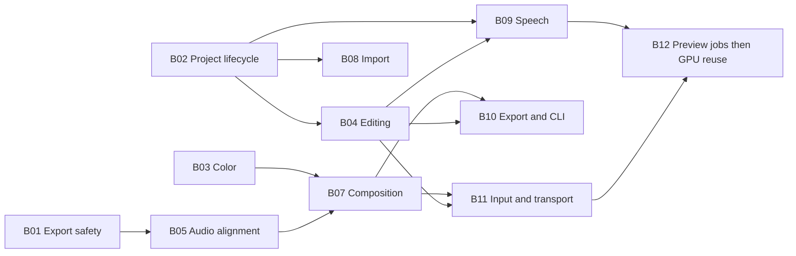

# Parallel remediation plan for issues 432 through 474

Use three reusable implementation worktrees, with the current checkout coordinating integration. Schedule all 43 issues as 12 batches across five waves. Each batch has one owner, an ordered issue list, and a bounded validation scope. A batch is a work assignment; keep individual issues reviewable without creating a checkout for each one.

The range contains **38 bugs and five enhancements**. The enhancements are #463, #465, #472, #473 and #474; they remain included. GitHub returned all 43 as open on 2026-10-25. Implementation scopes and acceptance criteria are in the [issue index](ISSUES.md) and [audit drafts](ISSUE-DRAFTS.md). The machine-readable schedule is [remediation-plan.json](remediation-plan.json).

Plan status: **implemented locally**, with all 43 issues integrated on `audit/432-474-integration` at product commit `f28cf2b2f4cf9a5287e98c4277053d39f5298c2e`. Three Orca worktrees were reused across the batches in run `run_8fb5c0f27f26`; #468/#472 were pulled forward, B10/B11 exchanged lanes, and B12 was staged around shared-file ownership. The schedule below records the original plan. Final issue outcomes, validation and remaining limits are in [REMEDIATION-RESULTS.md](REMEDIATION-RESULTS.md) and the manifest’s `execution` field. The baseline is `7efe671152a6c6a67bd31f9cbcb670748f73f57b`.

## Worktree allocation and schedule

Keep the current checkout for review, integration and shared test/catalog wiring. Create three related Orca worktrees named `audit-lane-a`, `audit-lane-b` and `audit-lane-c`, based on `origin/main`. Reuse those checkouts as their assignments change; each new issue branch starts from the latest accepted base after its prerequisites land.

| Wave | Lane A | Lane B | Lane C |
| --- | --- | --- | --- |
| 1 | B01: export data safety — #432 | B02: project lifecycle — #433, #437, #461, #469 | B03: color conversion — #447, #448 |
| 2 | B05: audio alignment — #440, #441 | B04: editing and selection — #434, #435, #436, #458, #459, #460 | B06: Inspector and scopes — #438, #455, #456 |
| 3 | B07: composition correctness — #446, #449, #445 | B08: import portability and order — #439, #462 | B09: speech analysis — #442, #443, #465 |
| 4 | B10: codec, CLI and sidecars — #450, #451, #444, #473 | B11: shortcuts and transport — #452, #453, #457, #470, #454, #463, #471, #472 | B12 first stage: waveform cancellation — #468 |
| 5 | Integrated export/audio/color verification | Native project/input verification | B12 remaining stages: filmstrips, scrubbing, repaint and texture reuse — #464, #467, #466, #474 |

Wave numbers describe a safe default schedule, not a requirement to wait for unrelated work. Advance a batch when its prerequisites have landed, its lane is free, and no active owner holds its source files. #468 changes only the waveform scan path and may be pulled forward into an idle slot. B12's preview changes wait for B11; #474 is last within B12.

Fix #432 and #433 as the first issue in their respective lanes, and review them immediately. Their remaining lane work need not delay either data-loss fix.

## Dependencies and ownership

The issues declare two implementation dependencies: **#434 before #435**, and **#447 before #448**. The following additional ordering is this plan's recommendation, based on shared state and files:

- Finalize voiceover safely (#433) before centralizing project replacement (#437). Establish session generations before changing import results, transcript ownership and asynchronous UI results.
- Establish ripple lock/link rules (#434, #435) and gesture boundaries (#436) before selection movement and keyframe paste work. Speech tools that issue cuts consume those settled command rules.
- Land timestamp handling (#440) before effect latency compensation (#441). Settle that playback/export code before changing still representation and frame rendering.
- Land RGBA stills (#446) and logical effect dimensions (#449) before extracting Program frame export (#445), so the shared frame operation includes their final semantics.
- Settle encoder color policy (#447) before encoder-family validation (#450). Finish export interface changes before phase reporting (#473).
- Settle composition and shortcut/transport UI before changing preview job delivery. Apply GPU resource reuse (#474) after completion, cancellation and frame ownership behavior are stable.



The graph combines implementation and integration ordering. B06 has no batch prerequisite. #468 can precede the B12 arrows; those arrows gate its remaining issues. The manifest records the complete batch prerequisites.

Keep a single active owner for `app.rs`, `timeline.rs`, `preview.rs`, `playback.rs`, `export.rs`, core `model.rs`/`history.rs`, media `encode.rs`, and `import.rs`. The schedule separates concurrent edits to these files. If an implementation needs an unlisted file owned by another lane, pause that part and coordinate the boundary before editing it.

`crates/jvid-app/src/app/tests.rs` is a shared test root in waves 2 and 3. Prefer tests in the affected component, or put new app regressions in a batch-specific child module such as `app/tests/audit_editing.rs`. The integrator adds the module declaration. Workers do not concurrently rewrite common harness helpers. Apply the same rule to other shared test roots and localization catalogs: supply separate test files or proposed key/value additions, with one owner applying their shared wiring. Keep snapshot updates limited to the affected controls.

## Batch implementation briefs

Paths below are relative to `crates/`, except where stated. Exact issue-level file scopes are retained in the manifest.

### B01 Export data safety

**Lane A, wave 1. Issue: #432.** Own app `export.rs`, `export/lossless.rs`, their export regressions, and media `remux.rs`.

Route Copy and Smart through an owned attempt directory and publish only a validated result. Reject output paths that identify any source, including supported symlink and hard-link aliases, before opening output. Limit cleanup to owned attempt files.

Verify early cancellation, failure after work begins, probe/mux failure and successful replacement over a sentinel destination. Compare exact destination/source bytes, check temporary-file cleanup, and exercise overwrite publication on Windows and Linux. Land this issue independently of later export changes.

### B02 Project lifecycle

**Lane B, wave 1. Order: #433 → #437 → #461 → #469.** Own app `app.rs`, `record.rs`, `import.rs`, transient timeline/preview/transcript reset paths, and `autosave.rs`.

Finalize the active take into History before close/New/Open dirty checking or Save. Then centralize successful project replacement and generation ownership, clear stale selections/clipboards/dialog state, fix named recovery Discard, and connect autosave scheduling to the configured cadence. Preserve the old session on failed Open and keep disk caches/layout reusable.

Verify FakeMic close/Save/Cancel flows and WAV lengths; delayed probes across two projects with colliding IDs; New/Open/recovery/tutorial transitions; named recovery discard/reopen; and fake-clock intervals of 15, 300 and zero seconds. Save must include the completed take, and Cancel must retain one undoable take.

### B03 Color conversion

**Lane C, wave 1. Order: #447 → #448.** Own media `encode.rs`, `proxy.rs`, `thumbnails.rs`, `decode.rs`, and the relevant render conversion shader/tests.

Define and test an explicit SDR conversion/metadata contract before applying it to auxiliary paths. Preserve metadata-aware matrix/range handling and the existing PQ/HLG view transform. Version both proxy and thumbnail caches when conversion changes.

Verify primary/gray patches, BT.601/BT.709, full/limited range, HD/SD output tags, and PQ/HLG original/proxy/poster agreement within documented codec/downsample tolerances. Compare available hardware and software encoders. Sources remain immutable and export continues to use originals.

### B04 Editing and selection

**Lane B, wave 2. Order: #434 → #435 → #436 → #458 → #459 → #460.** Own core `model.rs`/`history.rs`, app `timeline.rs`, keyframe/menu submodules, and the save/gesture boundary in `app.rs` after B02.

First compute the full ripple mutation closure and enforce downstream locks atomically. Reuse that policy for ripple delete without shifting linked groups twice. End history gestures on release/cancel and Save, then add atomic selected-set movement, model-coordinate marquee selection and explicit keyframe paste targeting.

Verify locked/unlocked linked A/V fixtures, disjoint deletes and exact undo/redo; two independent drags and drag/Save/drag/Undo returning to a clean saved state; group moves without internal overwrites; horizontal/vertical autoscroll selection; and keys copied from A to an unanimated selected B. All rejected edits leave project/history unchanged.

### B05 Audio alignment

**Lane A, wave 2. Order: #440 → #441.** Own app `transport.rs`, audio readers in `export.rs`, playback audio handling, media audio regressions, and audio `fx.rs`/`mixer.rs`.

Share timestamp-aware bounded buffering that preserves each decoded chunk's start, fills gaps with silence and trims overlaps. Then add an effect latency contract with bounded pre-roll/lookahead/flush behavior shared by playback and export, including cascaded clip and track cleanup.

Verify a +500 ms stream, independently delayed streams, seeks before/after audio start, AAC/MP3 priming and resampling. Use impulses and final-10-ms sounds with clip/track/both cleanup and an export starting inside a clip. Compare playback/export alignment and preserve duration and the processed tail.

### B06 Inspector and scopes

**Lane C, wave 2. Order: #438 → #455 → #456.** Own app `inspector.rs`, `scopes.rs`, their regressions and affected snapshots.

Resolve Inspector targets from explicit timeline selection before considering bin fallback. Add a shared width-aware numeric-row policy that retains numeric input and reserved tools. Give scope traces a palette consistent with their viewer background and invalidate cached colors when needed.

Verify unrelated retained titles/solids cannot be edited through mixed/audio-only selections. Assert actual slider/Reset/keyframe bounds at 240 and 288 points, with mixed/animated values and 1x/1.5x scale. Check waveform/vectorscope visibility in Light/Dark/High Contrast and while switching theme paused.

### B07 Composition correctness

**Lane A, wave 3. Order: #446 → #449 → #445.** Own app `playback.rs`, `preview.rs`, `export.rs`, frame-export dispatch in `app.rs`, media `stills.rs`, render effect/composition paths and shaders, and repo `docs/effects.md`.

Use cached RGBA still pixels with consistent orientation/alpha in Source, Program and export. Carry logical effect dimensions separately from sampled texel dimensions. Then extract an immutable-snapshot, full-resolution Program frame operation shared with video export, using originals and the same layer/effect semantics.

Verify transparent/half-alpha/opaque pixels over known backgrounds, transformed and masked effects, portrait/mixed source sizes, and Full/Half/Quarter/proxy comparisons. Test a title-only PNG, a different Source selection, composite/video pixel parity and an empty-timeline failure without a partial file. Preserve the full-quality appearance of saved projects and document custom-shader units.

### B08 Import portability and order

**Lane B, wave 3. Order: #439 → #462.** Own core `file.rs`, app `import.rs`/`project_file.rs`, and import regressions, after B02's session contract.

Normalize equivalent Windows ordinary/verbatim disk and UNC roots for relative path comparison while retaining truly different-volume fallbacks. Preserve input ordinals through asynchronous probe completion, skipping failures/duplicates without reordering remaining results.

Run the real importer/save/move/reload regression on native Windows, including UNC and different drives. Use gated probes finishing in reverse order to verify Match source and bin Added order; retain one undoable import batch and reject abandoned-session results.

### B09 Speech analysis

**Lane C, wave 3. Order: #442 → #443 → #465.** Own app `subtitles.rs`, `transcript.rs`, `transcript/fillers.rs`, `timeline/silence.rs`, `timeline/highlights.rs`, and the silence integration in `timeline.rs`.

Share explicit audio-source selection across transcription, captions, highlights and silence tools, with a visible choice for ambiguous linked groups. Preserve recognized language in a versioned transcript cache and match only its filler list. Cache source-level silence analysis by media identity, stream and settings, mapping cached intervals through trims/speed/reverse and rejecting stale asynchronous results.

Verify a fake multistream recording with speech only on Mic, reordered audio creation, whole-group ambiguity, multilingual true/false filler cases and cache reload. For 100 cuts of a two-hour source, count one scan per setting set and zero rescans on unchanged redraws. Compare cut spans against a reference for boundaries, padding, reverse and speed ramps, including undo.

### B10 Codec, CLI and sidecars

**Lane A, wave 4. Order: #450 → #451 → #444 → #473.** Own media `encode.rs`, app export execution/dialog/queue/tests, CLI main/tests, core subtitle traversal in `model.rs`/`history.rs`, and the affected README guidance.

Keep encoder fallback and stream validation inside the requested codec family. Make GPU acquisition conditional on a request needing composited video. Traverse nested subtitle timing and suppress subtitle text throughout the temporary sidecar-render copy, preserving ordinary media and nested containers on mixed tracks. Add export-specific phase/pass/retry/finalization reporting after those execution paths settle.

Verify injected encoder unavailability without relying on host codecs; H.264 output or a clear error preserving prior output; audio-only/lossless success without calling GPU acquisition; composited-video no-GPU exit code 4; and offset/trimmed/repeated nested captions with ordinary titles preserved. Verify normalization, multipass, retry, cancellation and finalization transitions in UI and CLI JSON. Completion follows validated publication and ETA does not promise an unknown remaining pass count.

### B11 Shortcuts and transport

**Lane B, wave 4. Order: #452 → #453 → #457 → #470 → #454 → #463 → #471 → #472.** Own app `app.rs`, `keymap.rs`, `keymap_editor.rs` and `preview.rs`, after B07's rendering changes.

Establish modal input ownership and exactly-once focused-widget/global dispatch first. Fix Source and Effects focus, budget the shared transport row for narrow/recording layouts, add clamped Source strip seeking, derive live hints from the keymap, and fit shortcut-editor chrome/list scrolling to the logical viewport.

Verify modal Ctrl+Z/Delete/Space and opening shortcuts cannot alter background state, while local text undo/Enter/Escape remain usable. Test Tab+Space on Play/shuttle/Record, remaps/unbound keys, immediate I/O after Source open, and Focus Effects. Assert transport hit bounds at 240/480/640/800 points during long takes and long translations at 1x/1.5x. Test a 30-minute Source seek and end clamps without moving the timeline playhead. Check shortcut-editor containment at 960×600, 768×480 and 640×400 with import errors.

### B12 Media jobs and GPU resource reuse

**Lane C, waves 4 and 5. Order: #468 → #464 → #467 → #466 → #474.** Own media `waveforms.rs`, app `media_bin.rs`, `timeline.rs`, `playback.rs`, `preview.rs`, and render `preview.rs`/tests. Only #468 runs alongside B10/B11; release the preview source files to B12 after B11 lands.

Poll cooperative cancellation during waveform scan and before publication. Deliver one filmstrip job's incremental and terminal results to every consumer, including late subscribers. Cancel obsolete stand-ins using wanted sets/generations before scheduling replacements, then notify the UI when current exact/stand-in work completes or fails. Finally retain compatible GPU upload resources with explicit in-flight image ownership and bounded reuse.

Verify bounded waveform shutdown with no completed/temporary cache after cancellation; bin-first/timeline-first/late-subscriber/failure/retry cases; gated A..Z scrubbing that skips obsolete B..Y; Play/relink cancellation; and idle parked seeks that repaint once useful work finishes without a permanent poll loop. Land these correctness fixes before #474. For texture reuse, assert post-warm-up allocation counts, alternate dimensions/preview scales/SDR/HDR, compare pixels and test scope/export captures for frame aliasing. Measure performance separately on a real adapter before claiming a speed gain.

## Review and integration workflow

1. Keep one owner per lane and only its current batch active. Refresh issue state and code, then reproduce the assigned failure before changing behavior. Use the issue's acceptance criteria as the completion checklist.
2. Preserve the repository's one-issue-per-PR convention from [CONTRIBUTING.md](../../../CONTRIBUTING.md). Reuse the same worktree for successive issue branches; each PR describes its own behavior and uses `Closes #N`. Commit shared prerequisites with the issue that introduces them, and base dependents on that accepted change. Batches do not require multi-issue PRs.
3. Integrate completed issues in their stated dependency order. A worker report includes commit/branch, issue number, changed files, regression result, targeted test commands, platform checks and any remaining acceptance gap. Do not close an issue based solely on an audit harness result.
4. Keep per-worktree build output separate. Generate a complete corpus once, then share it read-only using the supported `JVID_TEST_MEDIA` path; workers use separate temporary fixture/output/cache directories. A worker needing new generated corpus content provides the generator change for serial application.
5. Run meaningful component regressions while implementing, then the checks required by CONTRIBUTING before pushing. On each accepted wave, verify the combined tree once; rerun affected checks after conflict resolution.

Required repository checks are:

```sh
cargo fmt --all --check
cargo clippy --workspace --all-targets -- -D warnings
cargo test --workspace --no-fail-fast
```

For media/GPU acceptance runs, provide the generated corpus and a working test adapter and set `JVID_TEST_MEDIA_REQUIRED=1` and `JVID_GPU_TESTS=required` so skips cannot masquerade as passes. Follow CI's `JVID_X265_TESTS` setting for hosts with x265. Run localization guards for added UI messages. Use native Windows for #439 and destination replacement/alias behavior; retain Linux coverage for #432. Run native voiceover/input smoke checks and adapter-specific rendering checks where the corresponding issue requires them.

The final combined regression pass covers record → Save → New/Open, multistream import → speech cuts → Undo, linked ripple/group movement → Save/Undo, Full/Half/Quarter/proxy → PNG/video/sidecar export, and rapid parked seek → project replacement → job cancellation. Verify the existing release playback/performance gates from CI after the preview pipeline changes, and record #465 scan counts and #474 allocation/timing evidence separately.

Completion means every one of #432–#474 has its own acceptance evidence, merged prerequisites, passing required checks and no unresolved source ownership conflict. Planning coverage is checked separately from implementation completion.
